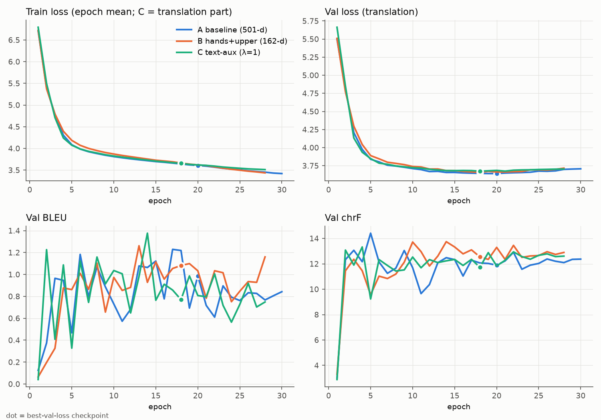
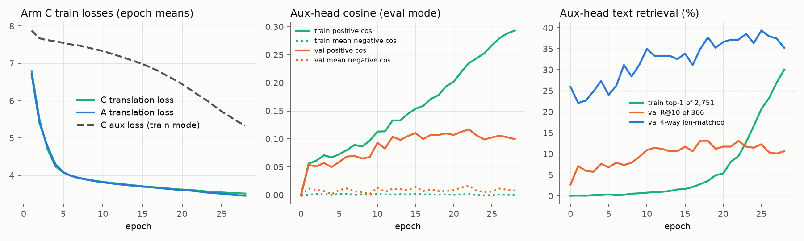

# P0.3 Controlled training intervention: results — 2026-10-02

**Status: complete.** Arm B and Arm C were trained one after the other, with the preregistered commands and no changes. All gate evaluations are done. Nothing committed or pushed. The setup/preregistration report (`docs/daily_report/9.29/asl-p03-controlled-setup/REPORT.md`) is unchanged.

## Bottom line

| Question | Answer |
|---|---|
| Does B (162-d hands+upper) pass the preregistered representation gate vs A? | **No.** Block 4 and T5 input are not significantly better than A on val, the frozen sign is negative for t5enc, and they are significantly *worse* than raw landmarks on TF-IDF. |
| Does C (text-grounded aux loss, λ=1, τ=0.07) pass the gate vs A? | **No.** Block 4 / T5-input differences vs A are +0.3 to +1.4 pp, all with CIs spanning 0. |
| Does any trained arm beat the raw-landmark P0.2 baseline? | **No.** Every arm at every checkpoint and stage is below it. **Of the 215 significant arm-vs-raw differences, all 215 are negative.** |
| Does any trained arm beat its own untrained (seed-42) init on the probe? | **No.** Many trained checkpoints are significantly *worse* than init (mainly epoch 5, and TF-IDF at best/final). |
| Did C's encoder change? | Yes, a lot: much less collapsed (T5-input cosine 0.940 vs A 0.998; block-4 cosine 0.50 vs 0.97). But this is **more variance, not more text-relevant variance**, because the probe did not improve. |
| Does C's aux objective generalise? | Only weakly. Train top-1 rises from 0.1% to 30% (memorisation), but val positive cosine plateaus at ≈0.10 from epoch 12. Aux-loss decrease is not success. |
| Translation | All three arms reach val BLEU ≈ 0.8–1.2 and chrF ≈ 12–13. At best-val, B − A chrF is +0.66 on val (95% CI excludes 0) and not significant on frozen; BLEU and WER differences are not significant. C − A: nothing significant at best-val. |

**Neither intervention produced a text-relevant learned representation by the preregistered standard.** The most consistent finding is that trained encoder representations (A, B and C) are no more text-predictive than the untrained network, and less so than the raw landmarks.

## 1. Checkpoints produced

| Arm | Run dir | Epochs run | Stop | Checkpoints | Evaluated (role → epoch → checkpoint) |
|---|---|---|---|---|---|
| A | `results/p02_padfix_10pct_e30` (reused, not retrained) | 30 | ran to the end | 30 | 5 → `checkpoint-1720`; best → 20 → `checkpoint-6880`; final → 30 → `checkpoint-10320` |
| B | `results/p03_controlled/armB_hands_upper162` | 28 | early stop (patience 10) | 28 (`checkpoint-344` … `checkpoint-9632`, 11 GB) | 5 → `checkpoint-1720`; best → 18 → `checkpoint-6192`; final → 28 → `checkpoint-9632` |
| C | `results/p03_controlled/armC_textalign_w1` | 28 | early stop (patience 10) | 28 (`checkpoint-344` … `checkpoint-9632`, 12 GB) | 5 → `checkpoint-1720`; best → 18 → `checkpoint-6192`; final → 28 → `checkpoint-9632` |
| Untrained refs | `results/p03_controlled/init_states/arm{A,B}_init` | — | — | 1 each (hash-checked: A `e651b023…`, B `f6209854…`) | epoch 0. `armA_init` is also C's reference (C base init = A init, asserted). |

The roles never coincided (5 ≠ best ≠ final in every arm), so 9 trained checkpoints and 2 init states were evaluated, with no duplicate computation.

Execution notes (no effect on the computation):
- No NaN/Inf. 0 non-finite step rows, no tracebacks.
- Arm C was paused for about 11 h overnight (2026-10-01/02), because the laptop slept on battery with the lid closed. The process resumed without restarting; epoch 12 wall time 41,351 s.
- Launch-time sha256 of all code (`LAUNCH_CODE_SHA256.txt`) still matched after training.
- The driver was `run_p03_continue.sh`. It took over (without restarting) the Arm B process started by `run_p03_full.sh`. Training commands are byte-identical to the setup report §9. It only de-duplicates the gate's `--epochs` list and adds the untrained-init references and the Arm C alignment trajectory.

## 2. Best epochs

| Arm | Best epoch | Best val loss (translation) | Final val loss |
|---|---:|---:|---:|
| A | 20 | **3.6415** | 3.7074 (ep 30) |
| B | 18 | 3.6583 | 3.7161 (ep 28) |
| C | 18 | 3.6747 | 3.7043 (ep 28) |

## 3. Training curves



- Translation train loss is practically identical across arms; Arm C's curve shows the translation part only.
- Val loss bottoms at epochs 18–20 in every arm, then rises slightly.
- Val BLEU fluctuates between 0.3 and 1.4 epoch to epoch in all arms. Single-epoch BLEU differences are noise at this level.
- Per-epoch tables: `data/armB_epoch_table.md`, `data/armC_epoch_table.md`.

## 4. Translation table

All metrics use full references, `full_ref`, as logged in training. Columns:
- rep3 = share of predictions with a repeated word 3-gram not present in the reference
- distinct-1 / distinct-2 = word / bigram type-token ratios
- top-1 = share of the most frequent prediction

| Arm | Ckpt | Val loss | **Val** BLEU | chrF | WER | unique /366 | top-1 | rep3 | distinct-1 / distinct-2 | mean words | **Frozen** BLEU | chrF | WER | unique /147 | top-1 | rep3 |
|---|---|---:|---:|---:|---:|---:|---:|---:|---|---:|---:|---:|---:|---:|---:|---:|
| A | 5 | 3.8390 | 0.47 | 14.41 | 1.237 | 15 | 0.825 | 0.943 | 0.004 / 0.006 | 24.0 | 0.34 | 13.21 | 1.175 | 6 | 0.864 | 0.973 |
| A | best 20 | 3.6415 | 0.99 | 11.89 | 1.047 | 206 | 0.052 | 0.719 | 0.021 / 0.054 | 17.2 | 1.02 | 11.12 | 1.025 | 102 | 0.068 | 0.762 |
| A | final 30 | 3.7074 | 0.84 | 12.37 | 1.043 | 331 | 0.019 | 0.669 | 0.038 / 0.111 | 16.6 | 0.99 | 11.43 | 1.022 | 137 | 0.027 | 0.701 |
| B | 5 | 3.8897 | 0.86 | 9.56 | 1.155 | 13 | 0.836 | 0.932 | 0.003 / 0.003 | 20.8 | 0.80 | 8.71 | 1.122 | 4 | 0.864 | 0.973 |
| B | best 18 | 3.6583 | 1.08 | 12.55 | 1.051 | 179 | 0.038 | 0.721 | 0.019 / 0.048 | 17.3 | 1.00 | 11.69 | 1.019 | 87 | 0.041 | 0.748 |
| B | final 28 | 3.7161 | 1.16 | 12.89 | 1.045 | 335 | 0.016 | 0.631 | 0.039 / 0.111 | 17.0 | 1.36 | 12.20 | 1.029 | 137 | 0.027 | 0.592 |
| C | 5 | 3.8486 | 0.33 | 9.23 | 1.079 | 36 | 0.544 | 0.732 | 0.006 / 0.012 | 18.3 | 0.34 | 8.09 | 1.073 | 19 | 0.646 | 0.823 |
| C | best 18 | 3.6747 | 0.77 | 11.73 | 1.053 | 263 | 0.041 | 0.702 | 0.026 / 0.068 | 17.1 | 1.15 | 11.19 | 1.025 | 125 | 0.034 | 0.755 |
| C | final 28 | 3.7043 | 0.75 | 12.61 | 1.039 | 338 | 0.019 | 0.612 | 0.042 / 0.119 | 16.8 | 1.10 | 12.25 | 1.020 | 142 | 0.034 | 0.660 |

At epoch 5 every arm is in the mode-collapse regime: a single repeated prediction covers 54–86% of clips. C collapses least (36 unique val predictions vs 15 / 13).

## 5. Semantic-probe table (frozen P0.2 harness, length-matched 4-way %, val / frozen; chance 25)

Columns:
- **raw** = raw-landmark P0.2/P0.2b probe for the arm's input: all/pos for A and C; hands+upper/pos for B
- **init** = the arm's untrained seed-42 network

| Text emb | Stage | raw (A/C) | raw (B) | A init | B init | A@5 | A@best | A@final | B@5 | B@best | B@final | C@5 | C@best | C@final |
|---|---|---|---|---|---|---|---|---|---|---|---|---|---|---|
| t5enc | Block 2 | 42.9/42.9 | 42.1/46.3 | 38.3/36.7 | 38.0/38.8 | 36.1/30.6 | 33.3/35.4 | 38.0/38.8 | 35.8/34.0 | 39.9/32.7 | 39.6/34.7 | 36.6/35.4 | 35.5/33.3 | 35.5/36.1 |
| t5enc | **Block 4** | 42.9/42.9 | 42.1/46.3 | 37.4/38.8 | 39.3/40.1 | 36.9/34.0 | **34.4/38.8** | 38.0/36.1 | 38.0/36.1 | **38.3/35.4** | 34.4/36.7 | 38.3/32.7 | **34.7/36.1** | 35.0/33.3 |
| t5enc | Bridge GELU | 42.9/42.9 | 42.1/46.3 | 38.8/35.4 | 39.9/42.9 | 36.3/36.1 | 35.0/34.7 | 35.8/35.4 | 37.2/34.0 | 41.3/37.4 | 33.6/34.7 | 36.1/36.1 | 36.9/36.1 | 33.1/34.0 |
| t5enc | **T5 input** | 42.9/42.9 | 42.1/46.3 | 37.4/35.4 | 40.4/42.2 | 38.3/34.7 | **35.8/38.1** | 35.5/34.0 | 38.5/34.7 | **40.7/34.7** | 34.4/34.7 | 35.5/38.8 | **36.9/37.4** | 36.1/34.0 |
| tfidf | Block 2 | 43.2/32.0 | 43.7/35.4 | 37.2/33.3 | 37.4/32.7 | 32.0/32.7 | 30.1/28.6 | 27.9/26.5 | 33.9/34.7 | 30.3/29.9 | 32.5/27.9 | 29.0/28.6 | 32.0/28.6 | 32.5/29.3 |
| tfidf | **Block 4** | 43.2/32.0 | 43.7/35.4 | 32.8/31.3 | 36.1/34.7 | 29.8/30.6 | **28.7/26.5** | 26.8/25.9 | 27.3/29.3 | **31.4/29.9** | 35.0/31.3 | 27.6/27.9 | **30.1/27.9** | 27.9/23.1 |
| tfidf | Bridge GELU | 43.2/32.0 | 43.7/35.4 | 28.1/29.9 | 35.2/29.9 | 29.2/28.6 | 26.5/23.1 | 27.9/25.2 | 29.2/28.6 | 30.6/25.2 | 32.8/29.9 | 25.4/30.6 | 27.0/25.9 | 30.6/21.8 |
| tfidf | **T5 input** | 43.2/32.0 | 43.7/35.4 | 29.0/29.9 | 35.2/30.6 | 27.0/32.0 | **28.7/28.6** | 27.6/26.5 | 29.5/32.7 | **29.8/21.8** | 33.9/29.3 | 23.5/27.2 | **30.1/25.9** | 30.9/23.8 |

Gate stages are in bold; the gate is evaluated at best-val. Random-negative 4-way and R@10 for every cell are in `data/metrics.json` (`probe`). The raw-landmark baselines reproduce P0.2/P0.2b exactly: asserted 42.9% / 42.1% val t5enc.

### Pre-registered gate (best-val; all of conditions 1–4 needed at block 4 OR T5 input)

| Arm | Stage | Text | Δ vs A@best, val (95% CI) | Δ vs raw, val (95% CI) | Δ vs A, frozen | Δ vs raw, frozen | Pass |
|---|---|---|---|---|---|---|---|
| B | Block 4 | t5enc | +3.8 [−1.9, +9.6] | −3.8 [−9.6, +1.9] | −3.4 | −10.9 | ✗ |
| B | Block 4 | tfidf | +2.7 [−2.7, +8.2] | **−12.3 [−18.9, −6.3]** | +3.4 | −5.4 | ✗ |
| B | T5 input | t5enc | +4.9 [−0.5, +10.7] | −1.4 [−7.4, +4.6] | −3.4 | −11.6 | ✗ |
| B | T5 input | tfidf | +1.1 [−3.8, +5.7] | **−13.9 [−20.5, −7.4]** | −6.8 | −13.6 | ✗ |
| C | Block 4 | t5enc | +0.3 [−4.9, +5.5] | **−8.2 [−14.5, −2.2]** | −2.7 | −6.8 | ✗ |
| C | Block 4 | tfidf | +1.4 [−4.1, +7.1] | **−13.1 [−19.4, −6.6]** | +1.4 | −4.1 | ✗ |
| C | T5 input | t5enc | +1.1 [−3.6, +6.0] | −6.0 [−12.6, +0.3] | −0.7 | −5.4 | ✗ |
| C | T5 input | tfidf | +1.4 [−4.1, +6.8] | **−13.1 [−19.4, −6.8]** | −2.7 | −6.1 | ✗ |

**B: gate not passed. C: gate not passed.** Not one condition 1 or condition 2 is met in any row. Full per-condition booleans: `data/gate_decisions.json`.

## 6. Checkpoint × layer representation table

See the §5 table, which covers all 4 stages × (5, best, final, init) × 2 text embeddings × val/frozen.

Model-native decoder scoring (frozen, n = 147, 147 × 147 teacher-forced NLL; length-matched 4-way %; chance 25):

| Run | raw NLL: 4-way len / R@10 / median rank | text-prior removed: 4-way len / 4-way rand / R@10 / median rank |
|---|---|---|
| A init | 25.2 / 7.5 / 77 | 23.8 / 24.5 / 1.4 / 79 |
| A@5 / best / final | 25.2 / 25.9 / 25.2 (R@10 6.8 / 7.5 / 8.2) | 27.2 / 21.8 / 30.6 (rand 33.3 / 38.8 / 40.1; R@10 15.0 / 16.3 / 15.6; med 54 / 48 / 45) |
| B init | 21.8 / 7.5 / 71 | 21.1 / 22.4 / 3.4 / 89 |
| B@5 / best / final | 25.2 / 27.2 / 27.9 (R@10 6.8 / 7.5 / 8.2) | 28.6 / 27.2 / 33.3 (rand 40.1 / 39.5 / 40.1; R@10 14.3 / 14.3 / 14.3; med 48 / 36 / 36) |
| C@5 / best / final | 25.9 / 27.2 / 26.5 (R@10 6.8 / 8.2 / 8.2) | 28.6 / 32.0 / 20.4 (rand 29.9 / 43.5 / 38.8; R@10 11.6 / 17.7 / 15.0; med 52 / 35 / 39) |

## 7. Collapse metrics (P0.1b, 100-clip frozen subset)

Metrics: inter-video cosine / clip-identity variance share / time-position variance share.

| Run | Block 2 | Block 4 | T5 input | Bridge cos-gap shrink (b4→T5) | id-share ratio b4/T5 |
|---|---|---|---|---:|---:|
| A init | 0.957 / 0.123 / 0.808 | 0.955 / 0.151 / 0.755 | 0.946 / 0.143 / 0.749 | 0.83 | 1.06 |
| A@5 | 0.887 / 0.038 / 0.900 | 0.998 / 0.012 / 0.874 | **0.9998** / 0.007 / 0.848 | 10.9 | 1.66 |
| A@best 20 | 0.208 / 0.323 / 0.312 | 0.966 / 0.107 / 0.639 | **0.9984** / 0.034 / 0.685 | 22.1 | 3.14 |
| A@final 30 | 0.184 / 0.337 / 0.236 | 0.888 / 0.202 / 0.456 | 0.9955 / 0.072 / 0.561 | 25.0 | 2.81 |
| B init | 0.953 / 0.116 / 0.759 | 0.954 / 0.140 / 0.714 | 0.945 / 0.136 / 0.690 | 0.82 | 1.03 |
| B@5 | 0.888 / 0.045 / 0.894 | 0.997 / 0.013 / 0.882 | 0.9997 / 0.007 / 0.873 | 9.3 | 1.72 |
| B@best 18 | 0.250 / 0.260 / 0.393 | 0.976 / 0.081 / 0.709 | 0.9986 / 0.027 / 0.766 | 17.7 | 2.98 |
| B@final 28 | 0.183 / 0.299 / 0.260 | 0.895 / 0.194 / 0.475 | 0.9952 / 0.074 / 0.620 | 21.9 | 2.64 |
| C@5 | 0.507 / 0.180 / 0.819 | 0.922 / 0.214 / 0.851 | 0.9983 / 0.054 / 0.925 | **46.7** | 3.94 |
| C@best 18 | 0.152 / 0.363 / 0.263 | **0.497 / 0.444** / 0.373 | **0.940 / 0.213** / 0.392 | 8.4 | 2.09 |
| C@final 28 | 0.136 / 0.320 / 0.233 | 0.554 / 0.313 / 0.347 | 0.951 / 0.171 / 0.315 | 9.1 | 1.83 |

**B** shows the same collapse/bridge-amplification profile as A, within a few percent.

**C** removes most of the block-4 collapse and much of the T5-input collapse at best/final. Its clip-identity share at T5 input is 6× A's, and bridge amplification falls from 22× to 8×. **None of this shows up in the probe** (§5): "more variance, not more text-relevant variance". At epoch 5, C's block 4 is already decollapsed, but its bridge still compresses it to 0.998 (shrink 47×).

## 8. Arm C auxiliary loss / alignment trajectory



Columns:
- **Train-mode** columns: epoch means logged during training (dropout + augmentation, per batch).
- **Eval-mode** columns: `analyse_p03_armC_alignment.py`, un-augmented, through the trained aux head. These are in the t5enc space, so they are circular and a training diagnostic, not the gate.

| Epoch | Train-mode: L_trans | L_aux | top-1 | mean rank | Eval: train aux CE | train top-1 /2,751 | train pos cos | train neg cos | val pos cos | val neg cos | val R@10 /366 | val 4-way len |
|---:|---:|---:|---:|---:|---:|---:|---:|---:|---:|---:|---:|---:|
| 0 (init) | — | — | — | — | 8.113 | 0.1% | 0.000 | −0.001 | 0.001 | 0.000 | 2.7% | 26.0% |
| 1 | 6.793 | 7.882 | 0.0% | 1147 | 7.687 | 0.1% | 0.056 | 0.000 | 0.054 | 0.012 | 7.1% | 22.1% |
| 5 | 4.074 | 7.551 | 0.2% | 848 | 7.463 | 0.4% | 0.073 | 0.002 | 0.059 | 0.009 | 6.8% | 24.0% |
| 10 | 3.824 | 7.334 | 0.4% | 660 | 7.220 | 0.8% | 0.113 | 0.002 | 0.093 | 0.013 | 10.9% | 35.0% |
| 15 | 3.707 | 6.982 | 1.0% | 460 | 6.794 | 1.7% | 0.154 | 0.002 | 0.111 | 0.015 | 11.7% | 33.9% |
| **18 (best)** | 3.656 | 6.679 | 1.9% | 332 | 6.445 | 3.6% | 0.178 | 0.001 | 0.107 | 0.007 | 13.1% | **37.7%** |
| 22 | 3.592 | 6.160 | 5.7% | 192 | 5.807 | 9.5% | 0.235 | 0.002 | 0.117 | 0.017 | 13.1% | 37.2% |
| 25 | 3.542 | 5.711 | 10.7% | 111 | 5.297 | 20.7% | 0.267 | 0.000 | 0.103 | 0.006 | 12.3% | 39.3% |
| 28 (final) | 3.512 | 5.337 | 19.3% | 71 | 4.942 | 30.1% | 0.293 | 0.000 | 0.100 | 0.008 | 10.7% | 35.2% |

All 29 rows: `data/alignment_trajectory.json`. Text-alignment retrieval during training was logged only as the per-batch train-mode top-1 and mean rank above. Val retrieval was not logged during training and was measured post hoc from the checkpoints.

What happened:
- The aux loss fell steadily: train-mode 7.88 → 5.34, about ln 2751 → 5.3.
- Most of the late fall is **memorisation of train sentences**: eval train top-1 rose from 3.6% at ep18 to 30.1% at ep28, and train positive cosine kept climbing.
- **Val positive cosine plateaued at ≈0.10–0.11 from epoch 12**, and val R@10 peaked at 13.1% (chance 2.7%).
- Negative cosines stayed ≈0, so the head separates the pairs it was trained on and generalises only modestly.
- The translation loss of C tracks A to within 0.01–0.06 at every epoch (curve panel 1). The aux loss did not visibly hurt or help translation.
- Even through its own trained head, in the space it was trained on, C's val 4-way (37.7% at best) stays below the raw-landmark ridge probe (42.9%). The two evaluators differ: zero-shot head vs fitted ridge, so this is indicative only.

## 9. A vs B paired comparisons

Paired bootstrap over queries, 2,000 resamples, seed 20260930, percentile 95% CI. Translation corpus metrics use 1,000 paired resamples. All tests: `data/paired_tests.json`.

**Representation (length-matched 4-way, gate stages):**
- Best vs best: t5enc block 4 +3.8 [−1.9, +9.6] val / −3.4 frozen; T5 input +4.9 [−0.5, +10.7] val / −3.4 frozen. TF-IDF: +2.7 / +1.1 val, n.s.
- Epoch 5: all gate-stage diffs n.s. (−2.5 to +2.5).
- Final vs final: TF-IDF block 4 **+8.2 [+2.2, +14.2]** and T5 input **+6.3 [+0.8, +11.7]** on val, but t5enc block 4 −3.6 val (n.s.). Frozen TF-IDF R@10 −5.4 (CI excludes 0).
- Non-gate stages at best: t5enc block 2 **+6.6 [+1.1, +12.0]** and bridge GELU **+6.3 [+0.5, +12.3]** on val. Neither holds on frozen (−2.7 / +2.7).

**Untrained inits:** B's init is already better than A's init in places, e.g. TF-IDF T5 input +6.3 [+1.4, +11.5] val. Training B then *lowers* most of these: B@best − B init, TF-IDF block 4 R@10 −4.6, CI excludes 0. So any input-ablation advantage is **present before training and is not created by learning**.

**Native decoder:** best vs best, all n.s. (text-prior-removed 4-way len +5.4 [−2.0, +12.3]).

**Translation (B − A):**
| Ckpt | Split | BLEU | chrF | WER | sentence chrF |
|---|---|---|---|---|---|
| 5 | val | **+0.39 [+0.10, +0.73]** | **−4.85 [−5.18, −4.50]** | **−0.08** | **−4.15** |
| best | val | +0.09 [−0.28, +0.43] | **+0.66 [+0.17, +1.15]** | +0.00 | **+0.68** |
| best | frozen | −0.02 [−0.56, +0.50] | +0.57 [−0.27, +1.39] | −0.01 | +0.56 |
| final | val | +0.32 [−0.06, +0.70] | **+0.53 [+0.01, +1.07]** | +0.00 | **+0.55** |
| final | frozen | +0.37 [−0.11, +0.98] | +0.76 [−0.14, +1.65] | +0.01 | +0.82 |

At epoch 5 both arms are degenerate (one repeated sentence per arm), so those differences reflect which sentence each arm repeats.

## 10. A vs C paired comparisons

**Representation:**
- At best, every gate-stage diff vs A is within ±1.5 pp and n.s., on both text embeddings and both splits (§5 gate table).
- Only non-gate positive: t5enc block 2 random-negative 4-way +6.0 [+0.8, +11.2] val.
- At epoch 5: R@10 +3.3 at block 2 / bridge GELU (val, CI > 0). Not a gate metric or stage.

**Native decoder (frozen, text-prior removed, length-matched 4-way):**
- C@best − A@best = **+10.2 [+0.7, +19.0]**
- **but** C@final − A@final = **−10.2 [−19.0, −1.4]**

The sign flips between adjacent checkpoints, the raw-NLL scores are n.s. (+1.4), and n = 147. I read this as noise, not a decoder-level effect.

**Translation (C − A):**
| Ckpt | Split | BLEU | chrF | WER | sentence chrF |
|---|---|---|---|---|---|
| 5 | val | −0.14 [−0.39, +0.17] | **−5.18** | **−0.16** | **−4.42** |
| best | val | −0.22 [−0.56, +0.08] | −0.17 [−0.60, +0.32] | +0.01 | +0.07 |
| best | frozen | +0.13 [−0.60, +0.89] | +0.07 [−0.87, +1.04] | +0.00 | +0.29 |
| final | val | −0.09 [−0.46, +0.26] | +0.24 [−0.38, +0.84] | −0.00 | +0.33 |
| final | frozen | +0.11 [−0.43, +0.70] | **+0.82 [+0.01, +1.57]** | −0.00 | **+1.03 [+0.21, +1.82]** |

Multiplicity: several hundred paired tests were run without correction. Only the preregistered gate is confirmatory; the isolated CI-excludes-0 results above are exploratory.

## 11–16. Answers to the preregistered questions

**11. Does B beat A?**
- **Representation: no.** The gate fails; best-val differences at block 4 / T5 input are +1 to +5 pp on val with CIs including 0, and reverse sign on frozen for t5enc.
- **Translation: marginally.** chrF is +0.5–0.7 on val at best/final (CI excludes 0), not confirmed on frozen. BLEU and WER are n.s.
- Val loss is slightly worse (3.658 vs 3.642).
- Removing nuisance dimensions did not measurably improve learning.

**12. Does C beat A?**
- **No**, on representation (gate fails, diffs ≈ 0) and on translation (n.s. at best).
- C does change the encoder geometry strongly (much less collapse), but not its text predictiveness.

**13. Does C beat the raw-landmark semantic baseline?**
- **No.** C@best is −8.2 [−14.5, −2.2] (t5enc block 4) and −13.1 (TF-IDF block 4 / T5 input) pp below raw on val.
- C also does not beat its untrained init: C@best − init at block 4 / T5 input is n.s. on both text embeddings, and several C@5 cells are significantly below init.

**14. Does representation improvement translate into BLEU/chrF/WER improvement?**
- There was no representation improvement to translate.
- C has the largest geometric change and shows no translation gain.
- B's small val chrF gain does not come with a gate-level representation gain.

**15. T5-embedding vs TF-IDF divergence**
- TF-IDF scores are uniformly lower than t5enc for learned features: 21–35% vs 33–41%. On frozen they are close to chance (22–32%), whereas raw landmarks reach 43% val under TF-IDF.
- Directional divergences:
  - B@final vs A@final: TF-IDF +8.2 at block 4 (CI > 0) vs t5enc −3.6.
  - B@best block 4: t5enc +3.8 val / −3.4 frozen vs TF-IDF +2.7 / +3.4.
- **The circularity risk for C did not materialise:** C shows no t5enc-specific gain over A even though it was trained in the t5enc space. Its aux head's gains did not transfer to the pooled block-4 features that the ridge probe reads.

**16. Does the decoder actually use any improved representation?**
- No evidence.
- Raw native decoder scoring is 25–28% for every arm and checkpoint, and 25% for the untrained init: the decoder's sentence ranking is dominated by the text prior.
- After removing the prior, all trained arms beat their init on random-negative 4-way and R@10 (+14 to +19 pp, CI > 0). Training teaches the decoder something clip-specific, but the same amount in A, B and C.
- C's +10.2 at best vs A is reversed at final (§10).

## 17. Recommended next experiment (not launched)

Both a cleaner input (B) and a direct text-grounding signal (C) leave the trained encoder **no better than its own random init and worse than raw landmarks** on the frozen semantic probe. C's aux head memorises train sentences (train top-1 30%) while val alignment plateaus at epoch 12. With 2,751 training sentences, the bottleneck looks like data scale or generalisation rather than nuisance dimensions or the lack of a text signal.

Recommended P0.4: **a no-training data-scaling diagnostic first.** Fit the same frozen P0.2 probe on raw landmarks and on Arm A best-val features using nested train subsets (e.g. 25 / 50 / 100% of the 2,751 clips), and report the val 4-way learning curves.
- **If the raw-landmark curve is still rising steeply at 100%,** the next training experiment should be Arm A at a larger How2Sign fraction, not another objective or input change.
- **If it is flat,** the 10% subset is not the constraint, and the encoder architecture/pooling (the P0.1 bridge amplification, still 17–25× in A/B) is the next target.

If Arm C is revisited, the evidence calls for selecting on a val alignment metric, which would be a protocol change requiring new preregistration. It should not be done post hoc on these runs.

## 18. Files created / modified

Model repo `~/Desktop/gloss-free-asl-translation`. Nothing committed; no tracked file modified. `git status`: only the untracked scripts listed in §20.
- Created by the training/eval driver:
  - `results/p03_controlled/armB_hands_upper162/`, `armC_textalign_w1/` (checkpoints, logs, predictions, epoch tables, summaries) and their `.log` files
  - `representation_eval/{armA_padfix,armB,armC,armA_init,armB_init}/`: per-checkpoint features, per-query outcomes, native NLL, `summary.json`
  - `gate_*.log`, `init_states/`, `init_states.log`, `armC_alignment/alignment_trajectory.json`, `armC_alignment.log`, `driver.log`
- Created by aggregation: `results/p03_controlled/analysis/{metrics.json,paired_tests.json,gate_decisions.json,training_curves.png,armC_alignment.png}`, `analysis.log`
- Scripts (untracked, written before launch; not modified this session): `scripts/train_p03.py`, `eval_p03_representations.py`, `prepare_p03_init_states.py`, `analyse_p03_armC_alignment.py`, `analyse_p03_results.py`

This worktree:
- **Created:** `docs/daily_report/10.2/asl-p03-controlled-results/REPORT.md`, plus `data/` (copies of the analysis outputs, gate summaries, alignment trajectory, run summaries/epoch tables, `driver.log`, `run_p03_continue.sh`)
- **Not modified:** the 9.29 setup report.

## 19. Reproduction commands

```bash
cd ~/Desktop/gloss-free-asl-translation && export HF_HUB_OFFLINE=1
# training (setup report §9, unchanged; run under bash)
bash -c 'source results/p03_controlled/common_args.sh && .venv/bin/python scripts/train_p03.py $COMMON \
  --arm B --output-dir results/p03_controlled/armB_hands_upper162' > results/p03_controlled/armB_hands_upper162.log 2>&1
bash -c 'source results/p03_controlled/common_args.sh && .venv/bin/python scripts/train_p03.py $COMMON \
  --arm C --aux-weight 1.0 --aux-temperature 0.07 --output-dir results/p03_controlled/armC_textalign_w1' > results/p03_controlled/armC_textalign_w1.log 2>&1
# representation gate (roles never coincided, so 5 best final for every arm)
.venv/bin/python scripts/eval_p03_representations.py --run-dir results/p02_padfix_10pct_e30 --name armA_padfix --epochs 5 best final
.venv/bin/python scripts/eval_p03_representations.py --run-dir results/p03_controlled/armB_hands_upper162 --name armB --epochs 5 best final
.venv/bin/python scripts/eval_p03_representations.py --run-dir results/p03_controlled/armC_textalign_w1 --name armC --epochs 5 best final
# untrained references
.venv/bin/python scripts/prepare_p03_init_states.py
for a in A B; do .venv/bin/python scripts/eval_p03_representations.py \
  --run-dir results/p03_controlled/init_states/arm${a}_init --name arm${a}_init --epochs 0; done
# Arm C alignment trajectory, then aggregation / statistics / plots
.venv/bin/python scripts/analyse_p03_armC_alignment.py
.venv/bin/python scripts/analyse_p03_results.py
```

The whole sequence is also captured in `results/p03_controlled/run_p03_continue.sh` (copy in `data/`).

Runtime:
- Training: B 2.38 h; C 16.7 h wall, of which ≈11 h was system sleep.
- Gate: ≈6 min per checkpoint (C best 25 min under load).
- Alignment: 25 min. Aggregation: ≈15 min.

## 20. Git status

Model repo (`~/Desktop/gloss-free-asl-translation`, HEAD `7da5734`): only untracked files, nothing staged or committed.
```
?? experiments/tiny_overfit/tiny32_seed20260924_manifest.json
?? scripts/{analyse_p03_armC_alignment,analyse_p03_results,compare_p03_configs,diagnose_collapse_trajectory,
            diagnose_encoder_collapse,eval_p03_representations,prepare_p03_init_states,probe_landmark_localization,
            probe_semantic_retrieval,smoke_p03,train_p03}.py
```
(`results/` is not tracked.)

This worktree (branch `baobao/asl-temporal-ablation-2026-09-06`): new untracked `docs/daily_report/10.2/` in addition to the untracked/modified files that already existed before this session. Nothing committed, nothing pushed.
