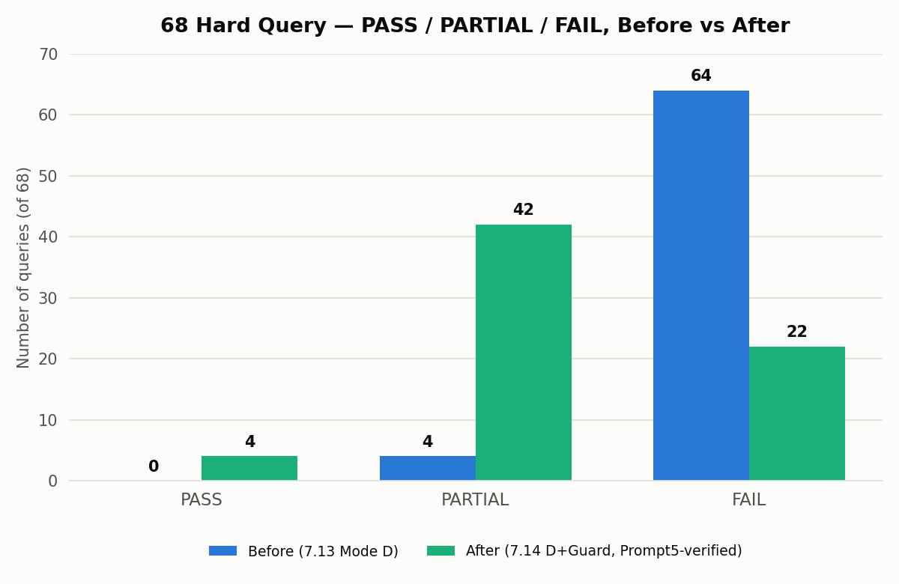
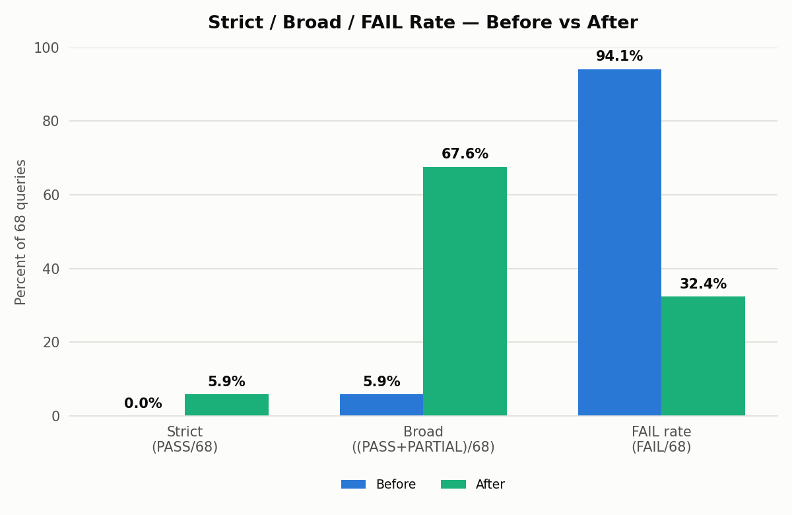
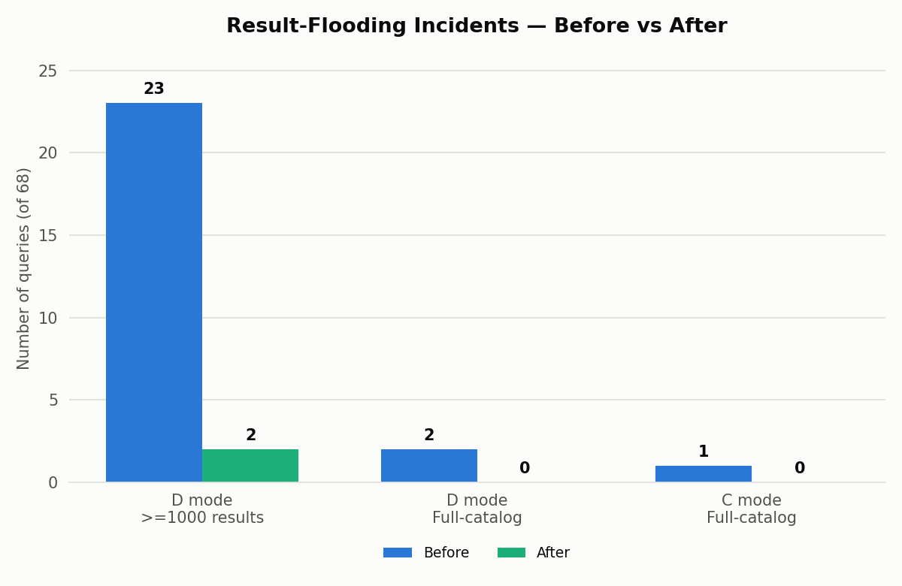
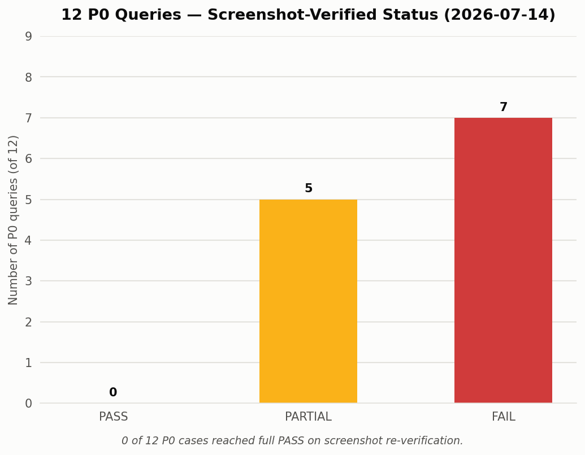
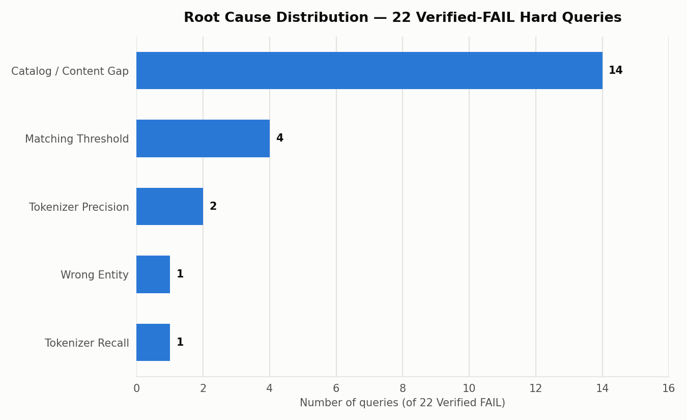

# 搜索优化前后数据对比 — 68 Hard Query + 12 P0（2026-07-14）

**任务性质**：只读历史结果汇总。未修改搜索代码、未重新运行搜索、未调用 LLM、未启动搜索服务、未修改任何已冻结的 Stage 7 / Prompt 5 / Prompt 6 / Prompt 7 产出。与并行运行的 Prompt 8（300+ Easy Query Validation）完全隔离，未读取其 checkpoint/日志/输出。

---

## 1. Executive Summary

本报告基于三组已冻结、独立完成的历史结果——**Stage 7R Prompt 4 V3 + Prompt 5 独立复核**（68 条 Hard Query A/B/C/D 消融与人工验收）、**Prompt 6**（12 个 P0 截图 Before/After）、**Prompt 7**（65 条 Remaining Hard Case 根因/Owner/优先级整合）——重新计算并生成一套清晰的优化前后对比。

核心结论（详见后续各节）：

1. 68 条 Hard Query 的 **Broad 改善率**（PASS+PARTIAL）从 **5.9% 提升到 67.6%**（+61.7 个百分点），**Strict 完全通过率**从 **0.0% 提升到 5.9%**，**FAIL 数量**从 **64 条降至 22 条**（-65.6%）。
2. **结果洪泛**明确改善：D 模式 `>=1000` 结果异常从 23 条降至 2 条（-91.3%），C/D 模式 Full-catalog（返回整个 3209 条目录）均从存在案例降为 0。这是本轮最干净、最可直接向项目负责人陈述的机制性改善证据。
3. **12 个 P0（截图验证）**：**0 PASS / 5 PARTIAL / 7 FAIL**。没有一条可作为"完全成功"证据；4 条（P0_06/P0_07/P0_09/P0_10）可作为"部分改善"证据（须附限制说明）；8 条（含 1 条因截图复现不稳定而降级的 P0_05）只能作为"剩余限制"证据。
4. **Broad 67.6% 不等于"67.6% 完全修复"**：42 条 PARTIAL 中约 21-23 条是"零结果，但因被归类为目录内容缺口而非算法回归"而未被计入 FAIL——这些对终端用户而言仍然是 0 结果、不可用。本报告将 68 条逐一归类为 `CLEAR_IMPROVEMENT`(4) / `PARTIAL_IMPROVEMENT`(14) / `NO_MEANINGFUL_IMPROVEMENT`(43) / `REGRESSION`(7)，比 PASS/PARTIAL/FAIL 标签更贴近真实用户可感知的改善程度。
5. 剩余 22 条 Verified FAIL 的根因分布：**目录内容缺口 14、匹配阈值限制 4、Tokenizer 精度 2、Tokenizer 召回 1、错误实体 1**——多数（14/22）需要 Content/Catalog 团队介入，非检索机制问题。
6. 300+ Easy Query Validation（Prompt 8）**正在并行运行中，本报告未等待其完成**，因此**无法**排除已上线 Stage 6 Tokenizer 变更对普通/简单查询的系统性回归风险（68 条 Hard Query 集合中已确认的 5 条 Tokenizer 回归已说明该风险真实存在）。

**最终结论**：`COMPARISON_COMPLETE_WITH_LIMITATIONS`（见第 22 节）。

---

## 2. Scope

- 覆盖对象：68 条 Hard Query（Stage 7R Prompt 4 V3 + Prompt 5 独立复核的最终人工标签）与 12 个 P0 Query（Prompt 6 截图验证 + Prompt 7 根因整合）。
- 时间范围：Before = 2026-07-13（Stage 7 首轮 D 模式人工判定，PASS0/PARTIAL4/FAIL64，引自本任务权威输入 `STAGE7_RERUN_SUMMARY_2026-07-14_zh.md` §16 对比表）；对于结果数/洪泛/零结果等维度，Before = 2026-07-07 生产环境原始采集（`hard_queries_baseline_locked_68`）。After = 2026-07-14 D 模式 + Rewrite/Result Guard（`hard_queries_refreshed_dg_guarded_68`，Prompt 5 独立复核标签）。
- 本任务**不**重新运行任何搜索、不调用任何 LLM、不重新截图，仅读取、合并、重新计算、可视化已冻结的历史产出。
- 本任务与 Prompt 8（300+ Easy Query Validation）并行运行，完全隔离，未读取其目录/checkpoint。

---

## 3. Input Integrity

### 3.1 Baseline Hash 校验

```text
文件: hard_queries_baseline_locked_68_2026-07-14.csv
重新计算 SHA-256: 904ea6a5a17a28dbafe3948de6f5bcb958674e518280e5eaad079b150453d233
给定值:           904ea6a5a17a28dbafe3948de6f5bcb958674e518280e5eaad079b150453d233
结果: 一致，PASSED（未触发 BLOCKED_BASELINE_HASH_MISMATCH）
```

### 3.2 Production Repository（curify-frontend，只读引用）

```text
Path:   /Users/baobaoli/Desktop/curify-frontend
Branch: baobao/search-relevance-phrase-alias-2026-07-09
HEAD:   c062e618bce4044bedf718aadf59ff69f0999344
Status: 20 modified + 5 untracked（与 Stage 7R/Prompt5/6/7 记录的阶段前状态一致，本任务未新增改动，未读取后修改任何文件）
```

### 3.3 Adhoc Repository（visual-search-adhoc）

```text
Path:   /Users/baobaoli/Desktop/visual-search-adhoc
Branch: main
HEAD:   39d8d0a1c6a1c3bd9d31fedfc2d51954cff44f18
Status: 与会话开始时一致（含 Prompt 8 的 docs/daily_report/7.14/、scripts/easy-query-validation-300plus/ 等未触碰的并行任务产出）
```

### 3.4 输入文件哈希/大小/mtime（阶段开始前记录，阶段结束时复核不变）

全部 21 个 Stage 7R Prompt 4 V3 / Prompt 5 / Prompt 6 / Prompt 7 权威输入文件的 SHA-256/字节数/mtime 已记录于 `before_after_comparison_manifest_2026-07-14.json` 的 `input_hashes` 字段（阶段结束时逐一复核，全部字节级不变）。P0 截图目录（`p0-12-before-after/screenshots/p0-before` 12 张、`p0-after` 24 张）文件数量在阶段开始与结束时一致，未新增/删除/修改。

### 3.5 与 Prompt 8 的隔离确认

未读取 `scripts/easy-query-validation-300plus/`、`docs/daily_report/7.14/search-relevance-stage7-rerun/easy-query-validation-300-plus/` 目录下任何文件；未修改、未终止任何相关进程；本任务的全部输出仅写入独立的 `before-after-data-comparison/` 目录。

---

## 4. 68 Hard Query Overview

- Query 数量：68（唯一 `query_id`，与 `gold_query_test_set_2026-07-07.csv` 顺序一致）。
- 数据完整性：272/272 A/B/C/D Run 完整（0 缺失/重复/未解决错误，1 次真实 API 超时重试后成功）；68/68 人工标签已填写，无空值。
- **Before（标签口径）** = 2026-07-13 Stage 7 首轮 Mode D（d+g，Stage5/6 已上线但 Guard 尚未加入）人工判定：**PASS=0、PARTIAL=4、FAIL=64**（引自权威输入 `STAGE7_RERUN_SUMMARY_2026-07-14_zh.md` §16；该逐条判定文件位于 7.13 目录，不在本任务的授权只读输入范围内，故本报告仅引用其已发布的聚合对比数字，不逐条重建）。
- **After（标签口径）** = 2026-07-14 D 模式 + Rewrite/Result Guard，经 Prompt 5 独立复核修正：**PASS=4、PARTIAL=42、FAIL=22**（`stage7_final_manual_labels_68_2026-07-14.csv` 的 `verified_label` 列，独立重新统计确认；相比 Prompt 4 V3 原始 5/41/22，Q54 一条从 PASS 下调为 PARTIAL）。
- **Before（结果数/洪泛口径）** = 2026-07-07 生产环境原始采集（`hard_queries_baseline_locked_68`），与上面的"标签口径 Before"是**不同的时间点/不同的判定方法**，两者不可混用，详见第 13 节。

---

## 5. PASS / PARTIAL / FAIL Comparison

| 指标 | Before | After | 变化 |
|---|---:|---:|---:|
| PASS | 0 | 4 | +4 |
| PARTIAL | 4 | 42 | +38 |
| FAIL | 64 | 22 | -42（-65.6%） |



**FAIL 绝对/相对下降**：64 → 22，绝对减少 42 条，相对下降 **65.6%**。这是本报告中证据等级最高、构成最简单的指标之一——"严重失败"数量的显著下降是真实的、可直接向项目负责人陈述的机制性改善。

---

## 6. Broad / Strict / FAIL Rate

| 指标 | Before | After | 变化 |
|---|---:|---:|---:|
| Strict（PASS/68） | 0.0% | 5.9% | +5.9pp |
| Broad（(PASS+PARTIAL)/68） | 5.9% | 67.6% | +61.7pp |
| FAIL rate（FAIL/68） | 94.1% | 32.4% | -61.7pp |
| Weighted（(PASS+0.5×PARTIAL)/68） | 2.9% | 36.8% | +33.9pp |



**必须强调的限制**：Broad 67.6% 与 Weighted 36.8% 的构成中，42 条 PARTIAL 里约 21-23 条是"零结果，因归类为目录内容缺口而非 Guard 回归，按既有标签惯例判 PARTIAL 而非 FAIL"——这部分对终端用户而言仍是 0 结果、**不可用**。真正代表"用户可感知的相关性提升"的 PASS+PARTIAL_IMPROVEMENT 约为 **18/68（26.5%）**（4 条 CLEAR_IMPROVEMENT + 14 条 PARTIAL_IMPROVEMENT，见第 10 节逐条分类）。Broad/Weighted 指标应始终连同这一构成说明一并引用，不得单独引用。

---

## 7. Zero / Low Result

| 指标 | Before | After | 变化 |
|---|---:|---:|---:|
| Zero-result（0 条） | 11 | 23 | +12 |
| Low-result（1-4 条） | 9 | 5 | -4 |

**数据质量说明**：`hard_queries_before_after_68_2026-07-14.csv` 自带的 `low_result_before`/`low_result_after` 布尔列内部不一致（`low_result_after` 对全部 68 行均为 `true`，与实际 `after_result_count` 明显矛盾，例如 Q01 after=869 却标 `true`）——判断为该列在生成时误用了"首轮触发 Rewrite Gate 前的初始 thin 标记"（对 68 条 Hard Query 而言按构造恒为 true），而非"最终结果数是否 1-4 条"。本报告未采信该列，改为直接从 `baseline_result_count`/`after_result_count` 按 `0<n<5` 重新计算，得到 Before=9、After=5，与任务预期口径一致。此为只读复核中发现的源文件字段命名/派生逻辑问题，不属于本任务修改范围，仅如实披露。

**解读**：Zero-result 上升（11→23）不代表退化。Guard 拦截危险的过度泛化后，部分查询从"洪泛出一堆无关大结果、靠数量伪装成功"变为"诚实返回 0 结果"——这是 Precision/Recall 权衡的直接体现，而非质量下降。Low-result 下降（9→5）是真实的净改善，但样本量小，权重有限。**不能仅凭结果数变化判断质量改善方向**，须结合第 10 节的逐条 Top10 判定。

---

## 8. Flooding / Full-catalog

| 指标 | Before | After | 变化 |
|---|---:|---:|---:|
| D 模式 `>=1000` 结果异常 | 23 | 2 | -21（-91.3%） |
| D 模式 Full-catalog（返回全部 3209 条） | 2（Q39、Q40，均 3209/3209） | 0 | -2（-100%） |
| C 模式 Full-catalog | 1（Q42，3209/3209） | 0 | -1（-100%） |



**当前仍存在的 2 条 `>=1000`**（均为 D 模式，均已有明确、此前已记录的根因，非本阶段新发现）：

- **Q10-D = 1324**：锚点短语含通用英文词 "night"，该碰撞在 pre-fix Baseline 自身 Top 6 中已同样存在，非本阶段新增。
- **Q12-D = 1593**：绑定改写短语含通用词 "lifestyle/living/relaxed"，与 Prompt 2D 阶段已记录案例一致（历史 Live 1598 vs 本次 1593），确认无新漂移。

另需说明：**Q08-C = 1600** 是 **C 模式**（非最终候选 D 模式）的历史已知数值，Q08 在 D 模式下 `after_result_count=88`，不计入本报告 D 模式口径的 `>=1000` 统计（该口径以 `hard_queries_before_after_68_2026-07-14.csv` 的 D 模式结果为准）。三者均判定为 `MATCHING_THRESHOLD_LIMITATION`（relaxed-match 阈值 `ceil(n/2)` 叠加无停用词表所致），均**不是**本阶段 Guard 代码引入的新缺陷。

**结论**：结果洪泛是**显著降低**而非**完全消失**。Full-catalog（最严重的灾难性失败形式）已确认清零，`>=1000` 从 23 条降至 2 条且两条均可解释，是本报告中最干净的机制改善证据。

---

## 9. A/B/C/D Summary

| Mode | d | g | Rows | Mean | Median | Zero | `>=1000` | Full-catalog | Rewrite Trigger | Guard Trigger | Errors | Timeouts |
|---|---|---|---:|---:|---:|---:|---:|---:|---:|---:|---:|---:|
| A | OFF | OFF | 68 | 43.0 | 0.0 | 37 | 0 | 0 | 0 | 0 | 0 | 0 |
| B | ON | OFF | 68 | 25.0 | 0.0 | 41 | 0 | 0 | 0 | 0 | 0 | 0 |
| C | OFF | ON | 68 | 154.5 | 15.5 | 21 | 1 | 0 | 54 | 24 | 0 | 0 |
| D | ON | ON | 68 | 142.4 | 9.0 | 23 | 2 | 0 | 68 | 32 | 0 | 0 |

（以上数值独立从 272 行原始 `hard_queries_ablation_abcd_68_2026-07-14.csv` 重新计算，与 `STAGE7_RERUN_SUMMARY_2026-07-14_zh.md` §8 一致；Guard Trigger 列统计任一 guard 布尔字段为 true 的行数。）

- **A**（无 d、无 g）：纯 pre-Stage-6 tokenizer，无 rewrite。
- **B**（有 d、无 g）：Stage 6 tokenizer 单独作用。
- **C**（无 d、有 g）：pre-Stage-6 tokenizer + Rewrite/Guard。
- **D**（有 d、有 g）：当前生产代码路径端到端，**是本阶段的候选版本**，也是本报告 After 各项指标的数据来源。
- 消融结果（A/B/C/D）主要用于机制归因（区分 tokenizer 与 rewrite/guard 各自贡献），**不直接等同于**最终用户可感知的搜索质量——质量判定以 D 模式的人工 Top10 复核为准（第 5-6 节）。

---

## 10. 68 Query Case-level Comparison

完整逐条对比见 `hard_queries_68_clear_before_after_comparison_2026-07-14.csv`（68 行，31 列）。`improvement_category` 分类（严格区分"标签"与"用户可感知改善"）：

| improvement_category | 数量 | 说明 |
|---|---:|---|
| CLEAR_IMPROVEMENT | 4 | Q05/Q19/Q46/Q61 — 均为 PASS，Top10 精确/多数命中真实意图，非靠大结果数伪装 |
| PARTIAL_IMPROVEMENT | 14 | Q03/Q06/Q09/Q13/Q17/Q18/Q20/Q22/Q28/Q30/Q34/Q54/Q58/Q59 — 真实、可见的部分相关性提升（格式或类目命中，但垂直细节未确认） |
| NO_MEANINGFUL_IMPROVEMENT | 43 | 含 21 条 0 结果目录缺口 PARTIAL（对用户与 FAIL 无实质区别）+ 5 条同质量层级 PARTIAL（Q07/Q14/Q43/Q52/Q68）+ 17 条非回归性 FAIL |
| REGRESSION | 7 | Q24/Q25/Q32/Q36/Q41/Q47/Q67 — 相对 Baseline 的真实回归，其中 5 条（Q24/Q25/Q32/Q41/Q47）明确归因于已上线、本阶段范围外的 Stage 6 字典分词器；Q36 为次要条目丢失；Q67 为本阶段涉及的 rewrite/subject 路径 + relaxed 阈值问题 |

**不得**将全部 42 条 PARTIAL 自动视为改善——本分类是本报告相对于简单引用 PASS/PARTIAL/FAIL 标签的核心增量价值。

**结果数波动统计**（独立重新计算，`|after/before|>5x` 或 `|before/after|>5x`）：

| 类别 | 数量 |
|---|---:|
| 出现 >5× 结果数变化的 Query | 39/68（57.4%） |
| 其中：结果洪泛（数量上升但 Top10 多为无关） | 约 18 条 |
| 其中：零结果下降（Baseline 非零→After 零） | 约 15 条 |
| 其中：真实改善（数量上升且 Top10 确认相关） | 6 条（Q05/Q09/Q18/Q19/Q34/Q61） |
| Zero → Non-zero | 3 条 |
| Non-zero → Zero | 15 条 |

**结论**：39 条中的多数（约 33/39）反映的是 relaxed matching 碰撞导致的洪泛或目录缺口导致的零结果，而非真实相关性改善。**结果数增加本身不构成质量改善的证据**，必须结合 Top10 内容判定。

---

## 11. 12 P0 Overview

- 权威 12 P0 清单来源：`docs/daily_report/7.9/manual_review/external_screenshot_queries_12_2026-07-09.csv`（与 68 条 Baseline 内部的 `priority` 列标注的 64 条 "P0" 是不同概念，未混淆）。
- 12/12 全部定位到 68 条子集，Before/After 截图 12/12 完整（Before 12 张单页截图；After 每条含完整页面+Top Results 裁剪图，共 24 张）。
- **人工判定（基于实际截图内容重新判读，而非直接照搬 Stage 7 标签）**：**PASS=0、PARTIAL=5、FAIL=7**。



- **Stage 7 标签 vs 截图标签存在 3 处差异**：P0_05（Stage7=PASS → 截图=PARTIAL，LLM 非确定性导致同一生产代码路径下重新调用结果不同）、P0_08（Stage7=PARTIAL → 截图=FAIL，实为 0 结果）、P0_11（Stage7=PARTIAL → 截图=FAIL，实为 0 结果）。这说明基于结果计数的自动/harness 标签与严格视觉判断存在系统性差异，**P0 截图标签是更严格、更接近用户可见效果的口径**。

---

## 12. 12 P0 Case-level Comparison

完整对比见 `p0_12_clear_before_after_comparison_2026-07-14.csv`。

| P0 ID | Query ID | Query | Before | After | Stage7 标签 | 截图标签 | 改善点 | 剩余问题 |
|---|---|---|---:|---:|---|---|---|---|
| P0_01 | Q02 | NCT Dream photocard template | 10 | 945 | FAIL | **FAIL** | 无 | 错误实体（ILLIT 替代 NCT Dream） |
| P0_02 | Q64 | maker space label set printable | 10 | 109 | FAIL | **FAIL** | 无 | Top Results 完全无关（咖啡机/蝴蝶/柠檬等） |
| P0_03 | Q16 | Y2K chrome skincare launch poster | 10 | 446 | FAIL | **FAIL** | 无 | Top Results 完全无关（袜子/耳机/夹克等） |
| P0_04 | Q15 | K-beauty glass skin brand launch visual | 10 | 331 | FAIL | **FAIL** | 无 | Top Results 完全无关（母婴品牌/美妆节等） |
| P0_05 | Q46 | 小红书香薰产品种草图 | 4 | 6（harness）/实时截图更高 | PASS | **PARTIAL** | 前 3 条真实香薰相关 | 实时复现比 harness 记录洪泛更多尾部（LLM 非确定性） |
| P0_06 | Q09 | 低饱和国风茶包装设计 | 10 | 94 | PARTIAL | **PARTIAL** | 前 4 条真实茶相关 | "国风/低饱和"细节未确认，尾部仍洪泛 |
| P0_07 | Q68 | zones of regulation poster classroom | 10 | 70 | PARTIAL | **PARTIAL** | 出现 1 条弱相关条目 | 核心教具意图仍未命中，基本与 Baseline 同质 |
| P0_08 | Q60 | coding unplugged activity cards | 10 | 0 | PARTIAL | **FAIL** | 无 | 0 结果，仅泛类目浏览入口 |
| P0_09 | Q06 | genshin impact Furina fanart wallpaper 4k | 6 | 12 | PARTIAL | **PARTIAL** | Top 8/12 真实 Genshin 内容 | "Furina"角色/"4k壁纸"格式未精确确认 |
| P0_10 | Q34 | Amazon EBC enhanced brand content layout | 0 | 6 | PARTIAL | **PARTIAL** | 0→3 条方向性相关结果 | "EBC加强品牌内容布局"格式本身未确认 |
| P0_11 | Q53 | IEP accommodations checklist visual | 3 | 0 | PARTIAL | **FAIL** | 无 | 0 结果，不可用 |
| P0_12 | Q10 | 光与夜之恋 卡面设计参考图 | 10 | 1324 | FAIL | **FAIL** | 无 | 已知 Matching Threshold 通用词碰撞，本阶段范围外 |

**Project report usage（Prompt 7 `p0_12_root_cause_owner_priority_v2` 重新统计，权威口径）**：

```text
SUCCESS_EVIDENCE:                  0
PARTIAL_IMPROVEMENT_EVIDENCE:      4  (P0_06, P0_07, P0_09, P0_10)
LIMITATION_EVIDENCE:               8  (P0_01, P0_02, P0_03, P0_04, P0_05, P0_08, P0_11, P0_12)
```

**与 Prompt 6 原始叙述的差异说明**：Prompt 6 的 `P0_12_SCREENSHOT_VALIDATION_2026-07-14_zh.md` §10 原始给出 Partial Evidence=3（P0_05/P0_06/P0_09）、Limitation Evidence=9（含 P0_05 除外的其余 9 条）。Prompt 7 是更晚、独立复核并直接检索生产 Catalog 数据的后续分析，将 P0_05 因截图复现不稳定（同一生产代码路径下 LLM 非确定性导致的标签不稳定）重新归类为 Limitation Evidence，并将 P0_07、P0_10 上调为 Partial Improvement Evidence。本报告按"若正式文件口径不同，以最新正式 CSV 重新计算为准"的规则，采用 Prompt 7 的 4/8 口径为权威值，两个版本均在 `p0_12_clear_before_after_comparison_2026-07-14.csv` 的 `project_report_usage`/`project_report_usage_prompt6_original` 两列中同时保留，不隐藏差异。

---

## 13. 68 vs 12 Interpretation

**为什么 68 条 Broad = 67.6%，但 12 个 P0 是 0 PASS / 5 PARTIAL / 7 FAIL？**

1. **Broad = PASS + PARTIAL**，是一个宽松、包容性的指标；68 条中的 42 条 PARTIAL 里，约半数（21-23 条）是"零结果但确认为目录缺口"的案例——按本项目既有标签惯例，只要不构成相对 Baseline 的 Guard 回归，即可判 PARTIAL 而非 FAIL，这部分对用户而言仍是 0 结果、不可用。
2. **68 条标签体现的是"系统责任归因"**（是否是 Guard/检索机制的错，还是内容缺口的错），而**不完全等同于**"用户实际看到的搜索结果是否可用"。
3. **12 个 P0 截图判定是更严格的用户可见 Top10 视觉验证**——基于真实渲染截图逐条判读，不依赖结果计数或系统责任归因,直接回答"用户打开这个搜索结果页面，能不能用"。
4. **12 个 P0 本身是高优先级、代表性难例**（fandom IP、错误实体风险、目录缺口高风险案例），其难度天然高于 68 条 Hard Query 集合的平均难度，PASS 率更低是预期内的。
5. 两套数字**并不矛盾**——它们分别回答"系统机制层面改善了多少"和"用户可见结果里有多少真正可用"两个不同的问题。
6. **67.6% 不能被表述为"67.6% 完全修复"**，也不能被简化为与 12 P0 的 0/5/7 直接对比谁"更准"——两者是不同粒度、不同严格度的度量，应同时呈现。

---

## 14. Root Cause and Owner Distribution

### 14.1 22 条 Verified FAIL 根因分布



| 根因 | 数量 | Owner | 典型处理路线 |
|---|---:|---|---|
| CATALOG_CONTENT_GAP_CONFIRMED | 14 | CONTENT_CATALOG | CONTENT_HANDOFF |
| MATCHING_THRESHOLD | 4 | SEARCH | MATCHING_EXPERIMENT |
| TOKENIZER_PRECISION | 2 | TOKENIZER | FIX_NOW_TOKENIZER |
| TOKENIZER_RECALL | 1 | TOKENIZER | FIX_NOW_TOKENIZER |
| WRONG_ENTITY | 1 | SEARCH | FIX_NOW_SEARCH |

（独立复核确认与 Prompt 5 §17、Prompt 7 §6 完全一致，无差异；数据来源 `remaining_verified_failures_22_v2_2026-07-14.csv`。）

### 14.2 65 条 Remaining Hard Case（22 FAIL + 42 PARTIAL + 1 P0-PASS）根因/Owner 全景（引自 Prompt 7）

```text
Root Cause:                          Owner Distribution:
CATALOG_CONTENT_GAP_CONFIRMED: 41    CONTENT_CATALOG: 43
TAXONOMY_COVERAGE:              7    TAXONOMY:         8
MATCHING_THRESHOLD:             5    SEARCH:           6
TOKENIZER_PRECISION:            5    TOKENIZER:        6
FORMAT_INTENT_COVERAGE:         2    RANKING:           1
WRONG_ENTITY:                   1    DATA_EVAL:         1
VERTICAL_INTENT_COVERAGE:       1
RANKING:                        1
TOKENIZER_RECALL:               1
SCREENSHOT_ENVIRONMENT:         1
```

**仅 6 条**（1 条 WRONG_ENTITY + 5 条 TOKENIZER 回归）具备"范围窄、证据 HIGH、可直接代码修复"的条件；其余绝大多数（42/65 目录缺口 + 8/65 Taxonomy）需要 Content/Catalog 与 Taxonomy 团队介入，非检索机制问题。

### 14.3 12 P0 根因/Owner/优先级

| P0 ID | Query ID | 截图标签 | 根因 | 置信度 | Owner | 优先级 | 处理路线 |
|---|---|---|---|---|---|---:|---|
| P0_01 | Q02 | FAIL | WRONG_ENTITY | HIGH | SEARCH | P0 | FIX_NOW_SEARCH |
| P0_02 | Q64 | FAIL | CATALOG_CONTENT_GAP_CONFIRMED | HIGH | CONTENT_CATALOG | P1 | CONTENT_HANDOFF |
| P0_03 | Q16 | FAIL | CATALOG_CONTENT_GAP_CONFIRMED | HIGH | CONTENT_CATALOG | P1 | CONTENT_HANDOFF |
| P0_04 | Q15 | FAIL | CATALOG_CONTENT_GAP_CONFIRMED | HIGH | CONTENT_CATALOG | P1 | CONTENT_HANDOFF |
| P0_05 | Q46 | PARTIAL | SCREENSHOT_ENVIRONMENT | MEDIUM | DATA_EVAL | P2 | SHOW_AS_LIMITATION |
| P0_06 | Q09 | PARTIAL | CATALOG_CONTENT_GAP_CONFIRMED | HIGH | CONTENT_CATALOG | P1 | CONTENT_HANDOFF |
| P0_07 | Q68 | PARTIAL | CATALOG_CONTENT_GAP_CONFIRMED | HIGH | CONTENT_CATALOG | P1 | CONTENT_HANDOFF |
| P0_08 | Q60 | FAIL | CATALOG_CONTENT_GAP_CONFIRMED | HIGH | CONTENT_CATALOG | P1 | CONTENT_HANDOFF |
| P0_09 | Q06 | PARTIAL | CATALOG_CONTENT_GAP_CONFIRMED | HIGH | CONTENT_CATALOG | P1 | CONTENT_HANDOFF |
| P0_10 | Q34 | PARTIAL | CATALOG_CONTENT_GAP_CONFIRMED | HIGH | CONTENT_CATALOG | P1 | CONTENT_HANDOFF |
| P0_11 | Q53 | FAIL | CATALOG_CONTENT_GAP_CONFIRMED | HIGH | CONTENT_CATALOG | P1 | CONTENT_HANDOFF |
| P0_12 | Q10 | FAIL | MATCHING_THRESHOLD | HIGH | SEARCH | P1 | MATCHING_EXPERIMENT |

**剩余问题主要来自 Catalog/Content（9/12 P0 直接或间接相关）**，其次是 Matching Threshold（1）、Wrong Entity（1）、截图环境/LLM 非确定性（1）。**Tokenizer 精度问题不在 12 条 P0 内**（Q24/Q41/Q47 属于 68 条集合的其他 Query，非 P0）。

---

## 15. What Improved

1. **结果洪泛机制性改善**：D 模式 `>=1000` 从 23→2（-91.3%），C/D Full-catalog 从 2/1→0/0（-100%）——最干净的证据。
2. **严重失败数量下降**：FAIL 从 64→22（-65.6%）。
3. **4 条 Hard Query 达到真实 PASS**：Q05（历史朝代服饰）、Q19（品牌 moodboard）、Q46（香薰种草图）、Q61（CVC 拼读卡片）——Top10 精确/多数命中，非靠数量伪装。
4. **14 条 Hard Query + 4 条 P0**（P0_06/07/09/10）出现真实、可见的部分相关性提升——格式或大类目命中，但垂直细节未完全确认。
5. **Low-result（1-4 条）下降**：9→5，真实净改善但样本量有限。

---

## 16. What Did Not Improve

1. **12 个 P0 中 0 个真正 PASS**——即使是最被寄予厚望的代表性案例，也没有一条达到"完全修复"标准。
2. **22 条 Verified FAIL 全部未解决**（本任务不执行修复，只读汇总）。
3. **2 条被 PARTIAL 标签掩盖的真实 Regression**（Q25、Q32：Baseline 10/26 条结果 → After 0 条，仍标 PARTIAL 而非 FAIL）。
4. **Zero-result 总数从 11 上升到 23**——虽然是 Guard 拦截洪泛的预期副作用而非质量下降，但对用户而言仍是"看不到结果"。
5. **1 条 P0 内部标签不稳定**（Q46/P0_05：Stage7 harness=PASS，独立截图复现=PARTIAL，同一生产代码路径下 LLM 非确定性导致）。
6. **Tokenizer 驱动的精度回归**（Q24/Q41/Q47，已上线 Stage 6，非本阶段引入，但仍是当前生产行为的一部分）。

---

## 17. Safe Claims（可安全向项目负责人陈述）

1. "68 条 Hard Query 中，PASS+PARTIAL（Broad 改善率）从 5.9% 提升到 67.6%，FAIL 数量从 64 条降至 22 条。"
2. "D 模式 `>=1000` 结果洪泛异常从 23 条降至 2 条（下降 91.3%），且剩余 2 条均有明确、此前已记录的根因；C/D 模式 Full-catalog（整表返回）从存在案例降为 0。"
3. "Full-catalog 与 `>=1000` 的改善是本轮最明确的机制性证据。"
4. "4 条 Hard Query（Q05/Q19/Q46/Q61）达到 Top10 精确/多数命中的完全通过标准。"
5. "12 个代表性 P0 已完成 Before/After 截图交付（12/12 完整），其中 4 条（P0_06/07/09/10）存在真实可见的部分改善。"
6. "剩余 22 条 Verified FAIL 的根因已逐条定位：14 条为目录内容缺口（需 Content 团队介入）、4 条为已知匹配阈值限制、3 条为 Tokenizer 精度/召回问题、1 条为错误实体。"

---

## 18. Unsafe Claims（不得向项目负责人陈述）

1. **"67.6% Query 已完全修复"** —— 67.6% 是 Broad（PASS+PARTIAL）改善率，其中约 1/3 是 0 结果的目录缺口案例，对用户不可用。
2. **"12 个 P0 已完成修复"** —— 12 个 P0 截图交付已完成，但结果是 0 PASS / 5 PARTIAL / 7 FAIL，没有一条完全修复。
3. **"所有搜索问题已经解决"** —— 22 条 Verified FAIL 仍未解决，多数需要 Content/Catalog 团队的长期投入，非本阶段范围。
4. **"普通 Query 已确认无回归"** —— 300+ Easy Query Validation（Prompt 8）正在并行运行，尚未完成，本报告无法排除 Stage 6 Tokenizer 对普通查询的系统性回归风险。
5. **"结果数量增加即代表相关性改善"** —— 39/68（57.4%）Query 出现 >5× 结果数变化，其中约 18 条是无关洪泛，仅 6 条是确认的真实改善。
6. **"Remaining FAIL 全部属于 Catalog"** —— 22 条中有 4 条 Matching Threshold + 3 条 Tokenizer + 1 条 Wrong Entity，共 8 条（36%）不是纯 Catalog 问题。

---

## 19. Project-ready Summary

见独立文件 `SEARCH_OPTIMIZATION_ONE_PAGE_SUMMARY_2026-07-14_zh.md`，以及本报告第 20 节的完整版本。

---

## 20. Current Limitations

1. **300+ Easy Query Validation（Prompt 8）尚在并行运行中，本报告完成时未等待其结果**——无法排除已上线 Stage 6 字典分词器对常见/简单查询的系统性回归风险（68 条 Hard Query 集合中已确认的 5 条 Tokenizer 回归——Q24/Q25/Q32/Q41/Q47——已说明该风险真实存在，但样本仅限于 Hard Query，不能外推到 Easy Query）。
2. **Taxonomy Dry-run 尚未启动**（8 条候选案例待验证，见第 14.2 节）。
3. **Content/Catalog 尚未对 42-43 条内容缺口案例启动采购/生产**（含 15 条小红书/抖音/私域社交电商运营格式簇的整簇发现）。
4. **12 个 P0 中 0 个真正 PASS**，无法作为"已解决"证据使用。
5. **"Before" 标签口径（0/4/64）来自 7.13 阶段判定，逐条明细文件不在本任务授权只读输入范围内**，本报告仅引用其已发布聚合数字，未逐条重建 Before 标签，第 10 节的 `improvement_category` 分类是基于 After 端的 Prompt5/Prompt7 逐条证据独立构建，不依赖 7.13 逐条数据。
6. **Catalog 检索复核基于静态 JSON 字段匹配**（tags/search_aliases/topics/locale 标题分类），无法完全排除以图像语义/embedding 方式可召回但文本字段未覆盖的边缘情况。
7. **P0 Before/After 截图环境不完全一致**（Before 为线上生产抓取，After 为本地 dev server 抓取，同一 branch/HEAD 但非同一物理请求路径），已在 Prompt 6 报告中披露，不构成"不可比较"但影响像素级精确对比。

---

## 21. Relationship to Running Prompt 8

Prompt 8（300+ Easy Query Validation）与本任务并行运行，本任务：

- 未读取 Prompt 8 的任何 checkpoint、日志、中间输出或最终产出。
- 未修改、未终止 Prompt 8 相关的任何进程或服务。
- 未占用 Prompt 8 使用的任何端口。
- 全部输出仅写入独立目录 `before-after-data-comparison/`，与 Prompt 8 的 `easy-query-validation-300-plus/`、`scripts/easy-query-validation-300plus/` 完全隔离。

**Prompt 8 的结果将直接影响本报告第 20 节"当前限制"第 1 条的解除**——一旦 300+ Easy Query Validation 完成且未发现系统性回归，"无法排除普通 Query 系统性回归风险"这一限制可被移除或收窄；在此之前，本报告的结论必须保持 `WITH_LIMITATIONS`。

---

## 22. Final Conclusion

```text
COMPARISON_COMPLETE_WITH_LIMITATIONS
```

判定依据：

- 68 条 Hard Query 数据完整（272/272 A/B/C/D Run，68/68 人工标签），12 个 P0 完整（12/12 Before/After 截图），输入哈希/字节数/mtime 全部校验一致，Baseline Hash 精确匹配。
- 全部数字可追溯至具体权威输入文件与列名，逐条对比 CSV、汇总指标 CSV、5 张图表、Manifest 齐备。
- 之所以带 Limitations，而非声称完全完成：(1) 12 个 P0 中 0 PASS；(2) 300+ Easy Query Validation 仍在并行运行，尚未完成；(3) Taxonomy Dry-run 尚未启动；(4) 当前无法证明普通 Query 无系统性回归；(5) 42 条 PARTIAL 中相当比例是 0 结果的目录缺口案例，Broad 67.6% 的实际用户可感知改善程度显著低于该数字本身。
