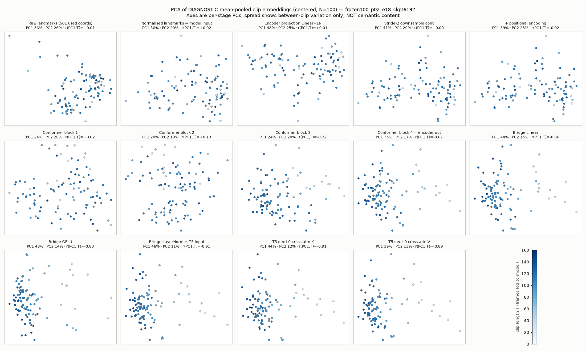
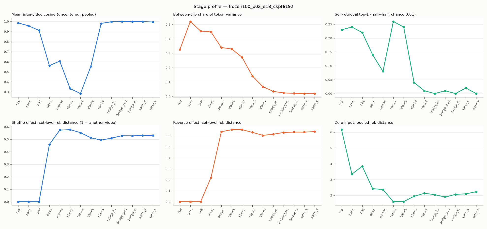

# P0.1 Encoder-collapse diagnosis — 2026-09-29

**Question.** Why is ~99.9% of the video-encoder output effectively the same across different videos?

**One-line answer.** The collapse is **learned in the last Conformer block (block 4)** and then amplified by the bridge's Linear+GELU. Raw and normalised landmarks are **not** collapsed, and blocks 1–2 of the trained encoder are the *most* video-specific stages in the whole path. From block 3 onward, the representation becomes a large constant vector plus a **time-index template shared by all videos**. At the T5 input, clip identity explains only ~2% of token variance, while the time index alone explains ~69%.

No training was run, no checkpoint was modified, and no model code was changed.

---

## 1. Setup

| Item | Value |
|---|---|
| Model repo | `~/Desktop/gloss-free-asl-translation`, branch `baobao/asl-tiny-overfit-2026-09-24` @ `7da5734` (unchanged) |
| Primary checkpoint | `results/p02_10pct_e30/checkpoints/checkpoint-6192`: best epoch 18, best val loss 3.63385 (verified in `results/p02_10pct_e30/summary.json`), model.safetensors sha256 `49397a7b…`; 214 keys, 0 missing, 0 unexpected |
| Comparison checkpoints | `results/p02_padfix_10pct_e30/checkpoints/checkpoint-6880` (post-padding-fix retrain, best epoch 20); seed-42 fresh init = the exact training init (sha256 `e651b023…` matches `run_config.json`) as an untrained control |
| Primary split | frozen test set: **100 of 147 clips** (from 93 distinct source videos), chosen by `random.Random(20260929).sample(sorted(ids), 100)` |
| Secondary split | val: 100 of 366 clips, same rule (same Kaggle extraction as training) |
| Sample IDs | `results/p01_encoder_collapse_diagnostic/<run>/sample_ids.txt` (per-clip details in `clips.csv`) |
| Execution | eval mode, **batch size 1** (no padding; mask all-valid), CPU, torch 2.10.0 / transformers 4.57.6 (same as training) |
| Script | `gloss-free-asl-translation/scripts/diagnose_encoder_collapse.py` (new, untracked) |
| Outputs | `gloss-free-asl-translation/results/p01_encoder_collapse_diagnostic/` (gitignored `results/`) |

## 2. Actual tensor path (from `src/dataset.py`, `src/models/manual_encoder.py`, `src/models/translation_model.py`)

| # | Stage | Shape per clip | Temporal axis | Pooling | Normalisation / projection |
|---|---|---|---|---|---|
| 0 | Raw MediaPipe Holistic `.npy` | (F, 543, 3) | yes | — | — |
| 0' | Raw, used subset (pose 33 + L-hand 21 + R-hand 21 + face-subset 92) | (T, 501) | yes | stride subsample to ≤150 frames (`features[::ceil(F/150)]`) | none |
| 1 | Normalised = **model input** | (T, 501) | yes | — | per frame: pose − mid-shoulder, hands − own wrist, face − face centroid, all ÷ shoulder width. **No per-channel standardisation.** Missing hands = 0. |
| 2 | `encoder.projection` | (T, 512) | yes | — | Linear(501→512) + LayerNorm |
| 3 | `encoder.downsample` | (T′=⌈T/2⌉, 512) | yes | stride-2 Conv1d(k=3) (**temporal downsampling, not pooling**) | — |
| 4 | + sinusoidal positional encoding | (T′, 512) | yes | — | absolute PE, per-token norm 16 |
| 5–8 | Conformer blocks 1–4 | (T′, 512) | yes | — | each: FFN½ → MHSA → Conv → FFN½ → **LayerNorm** |
| 9–11 | `modality_bridge` Linear → GELU → LayerNorm | (T′, 512) | yes | — | Linear(512→512), GELU, LayerNorm |
| 12 | Passed to T5 as `encoder_outputs.last_hidden_state` | (T′, 512) | yes | — | T5 encoder deleted; mask = downsampled mask, first position forced valid |
| 13 | Inside T5: decoder cross-attention K/V (layer 0 captured) | (T′, 512) | yes | — | T5 cross-attention has **no positional bias**, so it sees only the set of token contents |

**There is no pooling anywhere in the model.** The temporal axis reaches T5 intact. All "clip-level" numbers below use **diagnostic mean pooling over time**, which exists only in this analysis.

## 3. Quantitative results: primary run (frozen, 100 clips, checkpoint-6192)

Near-identical pair = uncentered cosine ≥ 0.999 of diagnostic-mean-pooled clip vectors. Cross-video pairs exclude clips from the same source video (4,932 pairs).

| Stage | Shape | Per-feature var | Mean inter-video cos | Mean L2 | Near-identical % (cos≥0.999) | Between-clip share of token var | Position share of token var | Common-component energy | Self-retrieval top-1 | Finding |
|---|---|---:|---:|---:|---:|---:|---:|---:|---:|---|
| Raw landmarks | (27..150, 501) | 0.0095 | 0.9852 | 1.68 | 0.8 | 0.33 | 0.01 | 0.955 | 0.23 | High cosine is a coordinate-offset artefact (centered cos ≈ 0); videos distinguishable |
| Normalised (model input) | (27..150, 501) | 0.074 | 0.9559 | 5.95 | 0.0 | **0.52** | 0.01 | 0.904 | 0.24 | Not collapsed. But 57% of variance comes from 10 hip/leg landmarks; hands 10%, face 0.5% |
| Projection Linear+LN | (27..150, 512) | 0.160 | 0.9106 | 8.37 | 0.0 | 0.46 | 0.01 | 0.830 | 0.22 | fine |
| Downsample conv | (14..75, 512) | 0.501 | 0.5617 | 14.6 | 0.0 | 0.45 | 0.02 | 0.363 | 0.14 | fine |
| + positional enc. | (14..75, 512) | 0.678 | 0.6059 | 15.0 | 0.0 | 0.34 | 0.27 | 0.343 | 0.08 | position signal enters |
| Conformer block 1 | (14..75, 512) | 0.851 | 0.3339 | 17.0 | 0.0 | 0.33 | 0.32 | 0.152 | **0.26** | most video-specific stage |
| Conformer block 2 | (14..75, 512) | 0.899 | **0.2839** | 15.9 | 0.0 | 0.27 | 0.39 | 0.107 | 0.24 | still video-specific |
| Conformer block 3 | (14..75, 512) | 0.845 | 0.5534 | 11.3 | 0.0 | 0.14 | 0.59 | 0.163 | 0.04 | **degradation starts** (identity ↓, position ↑) |
| **Conformer block 4 = encoder out** | (14..75, 512) | **0.191** | **0.9804** | 3.79 | 0.0 | 0.07 | 0.69 | **0.808** | 0.01 (chance) | **abrupt collapse** |
| Bridge Linear | (14..75, 512) | 0.242 | 0.9970 | 3.06 | 18.7 | 0.03 | 0.73 | 0.935 | 0.00 | amplifies |
| Bridge GELU | (14..75, 512) | 0.046 | 0.9995 | 1.12 | 86.5 | 0.02 | 0.69 | 0.981 | 0.01 | amplifies (largest cos step after block 4) |
| **Bridge LN = T5 input** | (14..75, 512) | 0.016 | **0.9991** | 0.62 | **69.9** | **0.02** | **0.69** | **0.968** | 0.00 | collapsed. LN itself does not collapse (β energy share 0.09%) |
| T5 dec L0 cross-attn K | (14..75, 512) | 1.41 | 0.9991 | 5.54 | 69.3 | 0.02 | 0.70 | 0.964 | 0.02 | inherits collapse |
| T5 dec L0 cross-attn V | (14..75, 512) | 1.73 | 0.9942 | 6.23 | 3.5 | 0.02 | 0.70 | 0.815 | 0.00 | inherits collapse |

Metric definitions (all in `summary.json → notes`):
- **Common-component energy** = ‖mean token‖² / mean ‖token‖².
- **Position share** = fraction of token variance explained by the time index t alone, i.e. the same for every video.
- **Self-retrieval** = the mean of a clip's first half must retrieve the same clip's second half among 100 clips (centered cosine; chance 0.01). It tests persistent **video identity only, not semantics**.
- At the T5 input, each token's centered cosine to the positional template built from *other* clips is **0.83**, versus ≈ 0 at the model input.

### Inside block 4 (where the collapse happens)

Every sub-module of block 4 writes a large, clip-independent vector into the residual stream:

| after | ‖token‖ | common-component energy | clip cos | between-clip share |
|---|---:|---:|---:|---:|
| block 3 out | 22.7 | 0.163 | 0.553 | 0.141 |
| b4.FFN1 | 39.1 | 0.383 | 0.858 | 0.085 |
| b4.MHSA | 52.5 | 0.632 | 0.933 | 0.105 |
| b4.Conv | 70.9 | 0.717 | 0.964 | 0.080 |
| b4.FFN2 | 91.6 | 0.807 | 0.980 | 0.074 |
| b4.final LN | 22.6 | 0.808 | 0.980 | 0.067 |

### Controls across runs (mean inter-video cos / between-clip share / self-retrieval top-1)

| Stage | frozen, e18 (primary) | val, e18 | frozen, padfix e20 | frozen, **untrained** seed-42 init |
|---|---|---|---|---|
| Normalised input | 0.956 / 0.52 / 0.24 | 0.950 / 0.58 / 0.24 | same input | same input |
| Conformer block 2 | 0.284 / 0.27 / 0.24 | 0.233 / 0.28 / 0.34 | 0.208 / 0.32 / 0.41 | 0.957 / 0.12 / 0.02 |
| Conformer block 4 | 0.980 / 0.07 / 0.01 | 0.977 / 0.07 / 0.01 | 0.966 / 0.11 / 0.03 | 0.955 / 0.15 / 0.02 |
| T5 input | **0.9991** / 0.02 / 0.00 | **0.9988** / 0.02 / 0.01 | **0.9984** / 0.03 / 0.01 | 0.946 / 0.14 / 0.02 |

- The same collapse appears on **val** (in-distribution Kaggle extraction), so it is not caused by the frozen set's different extraction.
- It also appears after the **padding-fix retrain**, so it is not caused by the padding bug.
- **The untrained model does not show the 0.999 collapse.** At init, the positional encoding (norm 16) dominates from the PE stage onward: 87% of token variance is position and self-retrieval is at chance. Training first made blocks 1–2 strongly video-specific, then blocks 3–4 and the bridge learned to write a video-independent "constant + clock" output.

### PCA





From block 3 onward, PC1 of the clip embeddings correlates with **clip length** (r = −0.72 at block 3, −0.87 at block 4, −0.91 at the T5 input; ≈ 0 before). Short clips (light points) spread out along PC1. This is consistent with a length/position template dominating what little between-clip variation remains. *PCA separation is not evidence of semantic content.*

Other runs: `results/p01_encoder_collapse_diagnostic/<run>/pca_clip_embeddings_all_stages.png`.

## 4. Temporal / input perturbations (frozen, 100 clips, e18)

The perturbation is applied to the input frames of the same clip. "Rel" = distance(original, perturbed) ÷ median distance(original, a different-video clip), so 0 = unchanged and 1 = as far away as another video. Set-rel uses a symmetric nearest-token distance between token sets, which is what position-agnostic T5 cross-attention can see.

| Stage | Orig vs Shuffle cos (pooled) | Orig vs Reverse cos (pooled) | Orig vs Zero cos (pooled) | Diff-video cos (reference) | Shuffle set-rel | Reverse set-rel | Zero set-rel |
|---|---:|---:|---:|---:|---:|---:|---:|
| Normalised input | 1.0000* | 1.0000* | 0.0000 | 0.9559 | 0.00* | 0.00* | 3.58 |
| Projection | 1.0000* | 1.0000* | −0.0587 | 0.9106 | 0.00* | 0.00* | 4.48 |
| Downsample conv | 0.9994 | 0.9999 | −0.1631 | 0.5617 | 0.46 | 0.22 | 2.73 |
| + PE | 0.9995 | 0.9999 | 0.0567 | 0.6059 | 0.57 | 0.64 | 2.03 |
| Block 2 | 0.8901 | 0.8641 | −0.0186 | 0.2839 | 0.55 | 0.66 | 1.33 |
| Block 4 (encoder out) | 0.9982 | 0.9974 | 0.9372 | 0.9804 | 0.49 | 0.61 | 1.67 |
| Bridge LN = T5 input | 0.9999 | 0.9998 | 0.9976 | 0.9991 | 0.53 | 0.64 | 1.62 |
| T5 cross-attn K | 0.9999 | 0.9998 | 0.9974 | 0.9991 | 0.53 | 0.64 | 1.64 |

\* Frame-wise stages are exactly permutation-equivariant, so mean pooling and set comparisons are unchanged by construction.

| Teacher-forced loss (100 clips) | original | shuffle | reverse | zero |
|---|---:|---:|---:|---:|
| mean | 3.709 | 3.704 (Δ −0.005; 52/100 clips worse) | 3.707 (Δ −0.002; 51/100 worse) | 3.839 (Δ **+0.130**; 80/100 worse) |

What this shows:
- **Same video run twice:** max abs difference 0.0 at every stage, including after other clips ran in between.
- **Temporal order is not lost at a single stage.** *Relative to the (collapsed) between-video distance*, shuffling or reversing moves the T5 input about 0.5–0.65 of the way to a different video, and this ratio is roughly constant from the PE stage onward.
- In absolute terms, all video-dependent variation, order included, is compressed into ~2–3% of the T5-input variance by block 4 + bridge.
- **The decoder does not use it.** Shuffle and reverse leave the loss unchanged (coin-flip 52/100 and 51/100). Zeroing the landmarks moves the representation ~1.6–2× a different-video distance and costs +0.13 loss. This matches the earlier finding that the model detects the *presence* of pose but not its temporal content.

## 5. Bugs and suspicious details checked

| Check | Result |
|---|---|
| Same landmark tensor reused | No: 0 duplicate model inputs, 0 duplicate raw files among 100 clips |
| ID / label mapping | Asserted per clip: dataset `file_id` = requested ID and text = metadata[ID] |
| NaN / Inf | 0 at every stage |
| Padding dominating / masks | bs=1 means no padding in the main analysis. Current code bs=8 vs bs=1: max abs diff 3e-6 (padding-invariant) |
| Eval path vs training path | The pre-fix encoder (commit `5b7eb92`, which checkpoint-6192 was trained with) gives **identical** output at bs=1 (diff 0.0). With padded bs=8 it differs by up to 0.63 at block 4 (mean token cos 0.9991). Simulated training batches were ~32% padding. The collapse is equally present in the padfix retrain, so this is **not the root cause**. |
| Checkpoint loading | 214/214 keys, 0 missing, 0 unexpected; model in eval mode. Only `encoder.pos_encoding.pe` (a constant buffer) equals the fresh-init value, so no untrained random component is used. |
| Temporal axis pooled too early | No pooling exists; stride-2 downsampling only |
| Cached / detached reuse | Rerun identical; perturbed inputs change outputs, so no caching |
| Bridge / projection degeneracy | Not degenerate: participation rank 206 (bridge) and 231 (projection) of 512. Bridge Linear condition number 7.7k (a few near-null directions). |
| LayerNorm collapsing differences | No: β energy share ≤ 0.09% in every LayerNorm; bridge LN slightly *reduces* cosine (0.9995 → 0.9991) |
| Normalisation over wrong axes / constant channels | Axes correct (per frame), 0 constant channels, 0 all-zero channels. **But** no per-channel standardisation: normalised pose dims carry 90% of input variance, and 57.5% comes from hip/leg landmarks 23–32, which are mostly out of frame in How2Sign. Hands carry ~10%, face 0.5%. Not a collapse, but it dilutes the hand signal. |
| Missing hands | 11–19% of frames have a zeroed hand (frozen); this does not drive PC1 (r ≈ 0) |
| Frozen vs train distribution | Frozen clips are longer (median 270 raw frames → stride-2 subsampled) than Kaggle train/val (median 145). The val run gives the same conclusions. |
| **Diagnostic bug found and fixed** | My first version called `torch.set_num_threads(8)`, which changes PyTorch's CPU weight init, so the "seed-42 init" hash did not match training. Removed; the hash now matches `run_config.json` exactly. **Reproducibility note:** the training init is only reproducible at the default thread count. |

## 6. Root-cause conclusion

**First abnormal stage: Conformer block 4** (the degradation begins in block 3), then amplification in the bridge Linear+GELU.

- Raw landmarks: **not** lacking variation (centered cos ≈ 0, self-retrieval 23× chance).
- Normalisation: **not** collapsing. It raises the between-clip share from 0.33 to 0.52, although the signal is dominated by lower-body pose.
- Blocks 1–2: the most video-discriminative representations in the path.
- Block 3: identity retrieval drops from 0.24 to 0.04; the position share rises to 0.59.
- **Block 4:** each sub-module adds a large shared vector (common energy 0.16 → 0.81; clip cos 0.55 → 0.98; per-feature variance ÷4.4; retrieval at chance).
- Bridge Linear + GELU: 0.980 → 0.9995 cosine. The bridge LayerNorm and the T5 interface do not add collapse.
- Pooling: not applicable (none exists).

What remains at the T5 input is ≈ 97% constant vector, and of the rest ≈ 69% is a time-index template shared by all videos. Only ≈ 2% is clip-specific.

This is **learned during training**; the untrained init does not show it. The measured behaviour fits the decoder treating the encoder output as a near-constant "prompt" plus a clock, and learning a generic language prior (the generic, repetitive predictions of P0.2). *This interpretation is a hypothesis.* The diagnostic shows where the collapse happens, not why the optimisation prefers it.

## 7. Recommended next action (nothing implemented; needs approval)

1. **(No training) Checkpoint trajectory.** Run the same script on the 28 saved epoch checkpoints of `p02_10pct_e30` to find when block 4 collapses (early vs gradual), which separates optimisation dynamics from capacity. This costs about 2.5 min per checkpoint.
2. **(No training, feeds P0.2) Probe block 2 vs block 4 vs T5 input** in the planned retrieval/discriminative probe. If block 2 carries text-relevant information that block 4 discards, the fix belongs at the top of the encoder, not in the data.
3. **Minimal model-side fix candidate** (one controlled 10% retrain, only after 1–2): add an anti-collapse term on the bridge output. Options are a clip-level variance/covariance (VICReg-style) regulariser, or a light video↔text contrastive loss. Report the between-clip share and wrong-video loss gap alongside BLEU. A zero-new-loss alternative is to feed T5 from block 2 (drop blocks 3–4), but that is an architecture change.
4. **Low-risk preprocessing hygiene** (separate, not the root cause): per-channel standardisation from train statistics, and dropping pose landmarks 23–32.

## 8. Reproduce

```bash
cd ~/Desktop/gloss-free-asl-translation
export HF_HUB_OFFLINE=1
P=scripts/diagnose_encoder_collapse.py
.venv/bin/python $P run --split frozen --checkpoint results/p02_10pct_e30/checkpoints/checkpoint-6192 --name frozen100_p02_e18_ckpt6192
.venv/bin/python $P run --split val    --checkpoint results/p02_10pct_e30/checkpoints/checkpoint-6192 --name val100_p02_e18_ckpt6192
.venv/bin/python $P run --split frozen --checkpoint results/p02_padfix_10pct_e30/checkpoints/checkpoint-6880 --name frozen100_padfix_e20_ckpt6880
.venv/bin/python $P run --split frozen --checkpoint random --name frozen100_seed42_init_untrained
.venv/bin/python $P aggregate
```

Each run takes ≈ 140 s on CPU and refuses to overwrite an existing output directory. Files per run: `summary.json` (all metrics, bug checks, parameter stats), `stage_metrics.csv`, `perturbation_per_clip.csv`, `clips.csv`, `sample_ids.txt`, `clip_pooled_embeddings.npz`, `SUMMARY.md`, two PNGs. Cross-run table: `CROSS_RUN_COMPARISON.md`.
