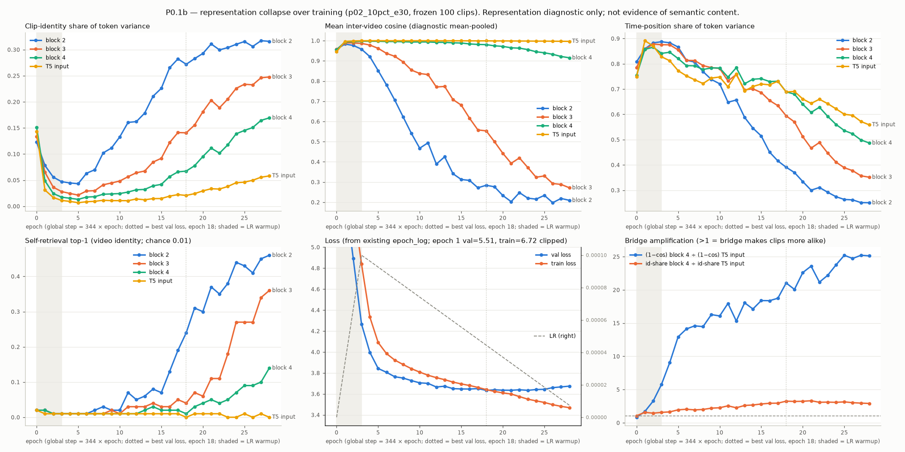

# P0.1b Collapse trajectory over training — 2026-09-29

**Question.** Does optimising the current translation objective progressively reduce video-specific information in the upper Conformer layers while training and validation loss improve?

**Answer (measured): not progressively.** The collapse is **abrupt and early**: 74% of block 4's init-to-trough drop in clip identity (82% at the T5 input) has already happened by the first checkpoint (epoch 1, step 344, still inside LR warmup). The minimum is at **epoch 5**. After that, the Conformer blocks **slowly regain** clip identity for the rest of training, including the epochs where validation loss still improves (5 → 18). Over the same period the **bridge compresses more and more**, so the T5 input remains ≥ 99.6% cosine-similar across videos at every trained checkpoint.

Nothing was trained. No checkpoint or model code was modified. Measurements reuse the P0.1 functions unchanged, and the P0.1 outputs were not touched.

> This is a representation diagnostic. Higher clip-identity share or lower cosine means the representation is **more video-specific**. It does **not** show that it carries ASL semantics.

---

## 1. Setup

| Item | Value |
|---|---|
| Run | `gloss-free-asl-translation/results/p02_10pct_e30`: 344 steps/epoch, bs 8, Adafactor, LR 1e-4, linear warmup 1032 steps (= epochs 1–3), then linear decay; early-stopped after epoch 28 (best val loss epoch 18) |
| Checkpoints | **29 states**: epoch 0 = the exact training init (seed 42; sha256 checked against `run_config.json`), plus all 28 saved epoch checkpoints `checkpoint-344 … checkpoint-9632` (strict load, 0 missing/unexpected keys). Epochs 29–30 do not exist (early stop). |
| Sample set | The **same** 100-clip subsets as P0.1 (`random.Random(20260929)`, asserted identical to P0.1 `sample_ids.txt`): **frozen test** 100/147 (primary) and **val** 100/366 (replication) |
| Stages | Conformer blocks 2, 3, 4; bridge GELU; bridge LN = T5 input (all stages captured; long CSV has every stage) |
| Method | `scripts/diagnose_encoder_collapse.py` (P0.1) imported unchanged: `Capture` hooks, `run_one` (bs = 1, eval, CPU), `token_metrics`, `clip_metrics`, same seeded token-pair RNG per checkpoint. Only original inputs (no perturbations). |
| **Validation of reuse** | Epoch 18 (`checkpoint-6192`) reproduces P0.1 **exactly** on both splits: max abs diff **0.0** for cos, L2, identity share and position share at all 5 stages |
| Joined, not rerun | val loss, train loss, LR, val/frozen BLEU, chrF, WER and unique-prediction counts, taken from the existing `epoch_log.jsonl` / `step_log.jsonl`. No translation eval was run. |
| Runtime | ~12 s per checkpoint; 343 s (frozen), 336 s (val) |

Metric definitions are identical to P0.1. **Clip-identity share** = between-clip fraction of token variance. **Position share** = variance explained by the time index alone. **cos / L2 / %≥0.999** are computed on diagnostic mean-pooled clip vectors over different-source-video pairs. **Self-retrieval top-1** = a clip's first half retrieves its own second half (chance 0.01).

## 2. Collapse trajectory (frozen test, 100 clips)

Each cell shows **cos / clip-id share / pos share**. ★ = best val loss. Shaded rows in the plot mark warmup. Full table: `data/trajectory_frozen100.csv`.

| Ep | Step | LR | Val loss | Frozen BLEU / chrF | Uniq. preds (/147) | Block 2 | Block 3 | Block 4 | Bridge GELU | T5 input | T5 %≥0.999 |
|---:|---:|---:|---:|---:|---:|---|---|---|---|---|---:|
| 0 | 0 | 0 | — | — | — | .957 / .123 / .81 | .957 / .134 / .79 | .955 / .151 / .76 | .953 / .142 / .75 | .946 / .143 / .75 | 0.0 |
| 1 | 344 | 3.3e-5 | 5.508 | 0.11 / 3.5 | 21 | .983 / .078 / .86 | .990 / .065 / .86 | .994 / **.049** / .86 | .997 / .032 / .89 | .996 / .031 / .89 | 41.8 |
| 2 | 688 | 6.7e-5 | 4.893 | 0.24 / 9.7 | 15 | .977 / .056 / .88 | .989 / .036 / .88 | .995 / .024 / .87 | .999 / .018 / .86 | .999 / .017 / .87 | 72.9 |
| 3 | 1032 | 1.0e-4 | 4.266 | 0.37 / 12.6 | 13 | .958 / .047 / .89 | .987 / .028 / .88 | .997 / .017 / .84 | 1.000 / .011 / .82 | .9995 / .011 / .83 | 83.8 |
| 5 | 1720 | 9.3e-5 | 3.843 | 0.79 / 8.6 | 9 | .852 / .043 / .87 | .962 / .021 / .86 | .997 / **.013** / .82 | 1.000 / .007 / .76 | .9998 / **.007** / .77 | **94.3** |
| 8 | 2752 | 8.1e-5 | 3.751 | 0.76 / 11.5 | 18 | .623 / .102 / .77 | .895 / .041 / .79 | .995 / .023 / .78 | 1.000 / .011 / .72 | .9996 / .011 / .72 | 88.2 |
| 12 | 4128 | 6.7e-5 | 3.666 | 0.53 / 7.3 | 26 | .389 / .162 / .66 | .771 / .064 / .76 | .992 / .032 / .79 | 1.000 / .014 / .75 | .9995 / .014 / .76 | 82.3 |
| 15 | 5160 | 5.6e-5 | 3.647 | 1.12 / 11.9 | 40 | .313 / .226 / .52 | .681 / .092 / .69 | .988 / .042 / .74 | 1.000 / .015 / .72 | .9994 / .015 / .72 | 80.7 |
| 18 ★ | 6192 | 4.4e-5 | **3.634** | 1.24 / 11.4 | 56 | .284 / .272 / .39 | .553 / .141 / .59 | .980 / .067 / .69 | .9995 / .023 / .69 | .9991 / .021 / .69 | 69.9 |
| 21 | 7224 | 3.3e-5 | 3.635 | 0.51 / 11.0 | 113 | .203 / .311 / .30 | .393 / .203 / .47 | .965 / .111 / .61 | .999 / .042 / .64 | .9985 / .034 / .64 | 48.0 |
| 24 | 8256 | 2.2e-5 | 3.642 | 0.65 / 10.3 | 115 | .215 / .310 / .27 | .324 / .226 / .41 | .945 / .139 / .56 | .999 / .071 / .61 | .9977 / .045 / .62 | 18.3 |
| 28 | 9632 | 7.4e-6 | 3.674 | 0.56 / 10.7 | 138 | .210 / .316 / .25 | .272 / .248 / .35 | .915 / **.169** / .49 | .998 / .118 / .53 | .9966 / .058 / .56 | 5.1 |

Mean L2 (frozen) moves with cosine. Block 4: 5.80 (e0) → 2.08 (e1) → 1.17 (e4, min) → 3.79 (e18) → 7.68 (e28). T5 input: 6.20 → 1.52 → 0.33 (e5) → 0.62 → 1.18.

**Val replication** (100 val clips, all 29 states) gives the same shape to within a few thousandths. Block 4 identity: 0.163 → 0.054 (e1) → 0.014 (e5 trough) → 0.070 (e18) → 0.174 (e28). T5 input: 0.152 → 0.035 → 0.008 (e5) → 0.022 → 0.058. T5 %≥0.999 peaks at 94.3% at epoch 5. Onset rule: epoch 1. Recovery above threshold: epoch 20 (19 on frozen).

## 3. Plots



Panels: clip-identity share, inter-video cosine, position share, self-retrieval (blocks 2/3/4/T5 input), val/train loss with LR, and bridge amplification. Val version: `figures/collapse_trajectory_val100.png`.

## 4. Findings

**4.1 First checkpoint where block 4 materially loses clip identity: epoch 1 (step 344).**
The rule was fixed before looking at val: first trained checkpoint with block-4 identity share < 50% of its init value. Frozen 0.151 → 0.049 (val 0.163 → 0.054). Cosine rises 0.955 → 0.994, and 12.6% of pairs are already ≥ 0.999 at block 4 (41.8% at the T5 input). No earlier checkpoint exists, so the onset can only be placed *somewhere within the first 344 steps*, while LR was ramping from 0 to 3.3e-5.
*Caveat:* the init's identity share of ≈ 0.15 is not "discriminative" (self-retrieval at chance). The init is dominated by the positional encoding (position share 0.75–0.81). "Loss of identity" at epoch 1 means the token variance became even more clip-independent than at random init.

**4.2 Gradual or abrupt? Abrupt onset, deepening to epoch 5, then slow partial recovery. It is not progressive.**
- The first 344 steps account for 74% (block 4) and 82% (T5 input) of the init → trough decline. The trough is epoch 5 for every stage, on both splits: just after warmup ends at epoch 3, near peak LR.
- From epoch 5 to 28, clip identity rises monotonically (with noise) at every stage. Block 4 goes 0.013 → 0.067 (e18) → 0.169 (e28), ending above its init value. Block-4 self-retrieval leaves chance only after epoch 18 (0.14 at e28).
- The T5 input never recovers: identity 0.058 at e28, versus 0.143 at init. ≥ 99.66% cosine at every trained checkpoint.

**4.3 Does block 2 stay video-specific throughout? No.**
Block 2 collapses too in epochs 1–5. Identity 0.123 → 0.043 (e5), cosine 0.98 at e1, self-retrieval at chance through epoch 10 on both splits. It becomes the most video-specific stage only later: identity 0.27 and self-retrieval 0.24 at e18; 0.32 and 0.46 at e28. It never shows near-identical pairs (max 1.3% ≥ 0.999 at e2; 0% from e5). The P0.1 picture "block 2 video-specific, block 4 collapsed" describes the **later** checkpoints. The gap is largest around epochs 10–15, where block-4 identity is only 17–19% of block-2 identity (54% by e28).

**4.4 Does decreasing validation loss correlate with increasing collapse? It depends on the phase. Over most of the run, the answer is no.**
Spearman ρ between val loss and identity share, frozen (val within ±0.1):

| Phase | n | Block 2 | Block 4 | T5 input | Direction |
|---|---:|---:|---:|---:|---|
| A: epochs 1–5 (warmup to trough) | 5 | +1.00 | +1.00 | +1.00 | val loss ↓ **with** collapse ↑ |
| B: epochs 5–18 (trough to best val) | 14 | −0.95 | −0.97 | −0.91 | val loss ↓ **with** collapse ↓ (identity recovers) |
| C: epochs 18–28 (after best) | 11 | +0.73 | +0.85 | +0.85 | val loss ↑ while identity ↑ (overfitting) |
| All trained | 28 | −0.78 | −0.70 | −0.58 | — |

Loss-improving optimisation is coupled with collapse **only in the first ~5 epochs**. Val loss drops 5.51 → 3.84 there, and the largest part of that drop coincides with the collapse. From epoch 5 to 18, val loss improves only a further 3.84 → 3.63 while identity recovers. Phase A has only 5 points, and all three phases are confounded with epoch and LR schedule, so these are descriptions, not causal estimates.
Frozen BLEU (0.1–1.3) and chrF (7–13) are noise-level at every checkpoint and do not track identity. The number of **unique frozen predictions** does track it (9 at e5 → 56 at e18 → 138 at e28; ρ = 0.95 with block-4 identity), but both are also monotone in epoch after e5.

**4.5 Does bridge amplification change over training? Yes. It grows steadily and does not reverse.**
- At init the bridge does *not* amplify. The (1−cos) ratio block 4 ÷ T5 input is 0.83 and the identity-share ratio is 1.06.
- (1−cos) shrink factor: 1.7 (e1) → 5.8 (e3) → 12.9 (e5) → 21.0 (e18) → 25.1 (e28). Val: 0.9 → 24.7.
- Identity-share ratio: 1.6 (e1) → 2.0 (e5) → 3.3 (e18), then a plateau around 2.9–3.2.
- As blocks 2–4 recover video-specific variance after epoch 5, the bridge Linear + GELU discards a growing fraction of it. By e28, block 4 is at 0.915 cos but the T5 input is still at 0.9966. Since epoch ~10, the bridge, not block 4, has been the main compressor.

**Scientific question.** Evidence *against* "progressive reduction under continued loss improvement". The reduction is concentrated in the first ~1–5 epochs (warmup and early peak LR), when val loss falls fastest. Continued optimisation after that *increases* video-specific variance in the Conformer blocks while val loss keeps improving slowly. The persistent near-constant T5 input in later training comes from a bridge that compresses more and more, not from continued encoder collapse.

## 5. Recommended next experiment (not started; needs approval)

**P0.2 retrieval/discriminative probe across checkpoints** (no training): {block 2, block 4, T5 input} × {epoch 5 (trough), 18 (best), 28 (most recovered)} on the same 100 clips. Test whether the variance that returns after epoch 5, and is then removed by the bridge, carries anything text-relevant. The trajectory now says *where* (bridge) and *when* (first ~1000 steps) to intervene. Whether the recovered block-2/4 variance is worth preserving is unknown until it is probed.

For later, once the probe has run, the trajectory points at two candidate training-side levers, both unimplemented: (a) the **early phase**. The collapse forms within the first 344 steps, so an anti-collapse term or an encoder-first/decoder-frozen warmup would have to be active from step 0. (b) the **bridge**, whose compression grows monotonically.

## 6. Files

Model repo (`~/Desktop/gloss-free-asl-translation`, untracked / gitignored, nothing committed):
- `scripts/diagnose_collapse_trajectory.py`: P0.1b driver that imports the P0.1 script. `--reanalyse` rebuilds the analysis, table and plot from `trajectory.json` without re-measuring.
- `results/p01b_collapse_trajectory/{frozen,val}/`: `trajectory.json` (all per-checkpoint metrics for all stages + analysis + P0.1 reproduction check), `trajectory_focus_wide.csv`, `trajectory_long.csv` (every stage), `TRAJECTORY.md`, `collapse_trajectory.png`, `sample_ids.txt`
- `results/p01b_collapse_trajectory/frozen/trajectory.measured_snapshot.json`: the measurement before `--reanalyse` (stages verified identical)
- `results/p01b_collapse_trajectory/val_run.log`; `results/p01b_val_aborted_partial_20260929/`: an earlier val attempt that stopped after epoch 27, kept aside (its epochs 0–27 match the completed run)

This worktree: `docs/daily_report/9.29/asl-p01b-collapse-trajectory/` (this report, `figures/`, `data/`). P0.1 (`asl-p01-encoder-collapse/`, `results/p01_encoder_collapse_diagnostic/`) is unchanged.

## 7. Reproduce

```bash
cd ~/Desktop/gloss-free-asl-translation
export HF_HUB_OFFLINE=1
.venv/bin/python scripts/diagnose_collapse_trajectory.py --split frozen   # refuses to overwrite
.venv/bin/python scripts/diagnose_collapse_trajectory.py --split val
.venv/bin/python scripts/diagnose_collapse_trajectory.py --split frozen --reanalyse   # derived files only
```
