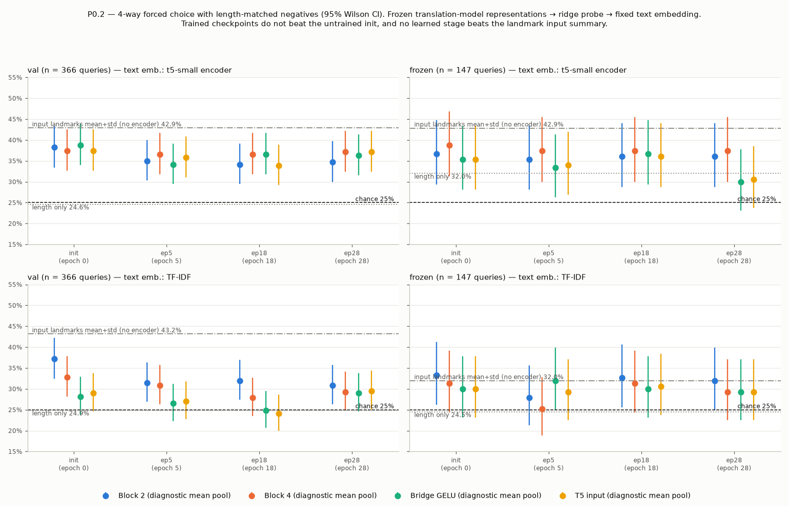

# P0.2 Semantic / discriminative probe of the learned video representations — 2026-09-29

**Question.** Does the representation that recovers after the early collapse (P0.1b) carry text-relevant information, or only video/signer/pose-specific variation?

**Answer (measured, linear probe).** **No evidence that it carries text-relevant information.** Every stage is weakly but reliably above chance at matching a clip to its English sentence. The **untrained initialisation does just as well**, and **the plain landmark input summary (no encoder) does at least as well as every learned stage**. On val it is significantly better. Paired tests show:
- **Recovered vs collapsed (ep28 − ep5):** no difference at block 2, block 4 or the T5 input.
- **Trained vs init:** trained checkpoints are equal or slightly worse at every stage.
- **The bridge:** the trained bridge does not remove more linearly decodable text information than the untrained architecture already does.

The variance that returns after epoch 5 is, as far as this probe can see, not text-relevant.

Nothing was trained except the lightweight probes (train split only). No translation-model weight, architecture, landmark or preprocessing change was made. P0.1 and P0.1b outputs are untouched.

> Scope: a linear probe on diagnostic mean-pooled clip vectors. "Above chance" means *linearly predictive of which English sentence belongs to the clip*. It is not proof of ASL semantics, and "not above baseline" does not rule out non-linear or temporal information a stronger probe could find.

---

## 1. Data, labels and leakage (checked first)

| Item | Finding |
|---|---|
| Splits (existing, pinned) | **train 2,751** clips / 1,208 source videos; **val 366** / 366 videos (one clip each); **frozen 147** / 128 videos. The frozen set is evaluation-only. |
| Labels available | One English sentence per clip (`SENTENCE`). **No gloss, sign, phrase, topic or signer labels exist** in any local metadata, so none were invented. |
| Signer | **Not available.** `split_by_signer` finds no signer column and falls back to the filename prefix, i.e. the **YouTube source-video ID**. The "signer-independent" split is therefore a **source-video-disjoint** split. Signer overlap between splits **cannot be verified**, and signer encoding cannot be tested. |
| Source-video overlap | train∩val = train∩frozen = val∩frozen = **∅** |
| Clip overlap | none |
| Exact duplicate sentences | train: 18 groups / 51 clips (all short: "okay" ×7, "hi" ×4, "there we go" ×4…); **val 0, frozen 0**. Cross-split: train↔val "good", "ok"; **train↔frozen none, val↔frozen none**. |
| Near-duplicates (token Jaccard ≥ 0.8, ≥ 4 words) | 1 pair train↔val ("one two three one more four" / "four one two three four"); **0** involving frozen; 0 within val/frozen |
| Duplicate landmark inputs | **0** duplicate `.npy` files (sha256) among all 3,264 clips |
| Same-video siblings inside eval sets | frozen: 38 clips in 19 same-video pairs; val: 0. 4-way negatives never come from the query's source video. |
| **Clip length vs sentence length** | Spearman(raw frames, word count) = **0.87 train / 0.82 val / 0.85 frozen**. Length is a strong nuisance cue, hence the length-matched 4-way test and the length-only baseline. |

Full output: `data/leakage_checks.json`; per-clip table in `results/p02_semantic_probe/checks/clip_table.csv`.

## 2. Probe design

| Component | Exact choice |
|---|---|
| Model states (frozen, `eval()`, never trained) | **init** = exact training init (seed 42; sha256 = `run_config.json`); **ep5** `checkpoint-1720`; **ep18** `checkpoint-6192` (best val loss); **ep28** `checkpoint-9632`. Strict load, 0 missing/unexpected keys. |
| Stages | Conformer block 2, block 4, bridge GELU, bridge LN (= the T5 input) |
| Extraction | P0.1 code imported unchanged (`Capture` hooks + `run_one`): batch size 1, no padding, all-valid mask, same normalisation. **Verified:** ep18 vectors equal the P0.1 saved vectors on its 100 frozen clips, max abs diff **0.0** at all 4 stages. |
| Clip vector | **DIAGNOSTIC mean over time** of each stage's per-token output. The model itself never pools; T5 cross-attends to all tokens. Sensitivity check: mean+std pooling for ep18/ep28 (in `TABLES.md`; no change in conclusions). |
| Text representation (fixed, not trained) | **Primary**, fixed before any result: pretrained **t5-small encoder** (local HF cache), mean-pooled over tokens, L2-normalised. 512-d. Independent of the translation model, whose T5 encoder is deleted. **Secondary**: word **TF-IDF**, vocabulary (df ≥ 2, 2,409 words) and IDF from **train sentences only**. |
| Probe | Closed-form **ridge regression** from the standardised clip vector to the text vector. **Fit on the 2,751 train clips only.** λ from a 17-value grid (10⁻¹ … 10⁷) by **5-fold CV on train, grouped by source video** (criterion MRR). Val and frozen are never used for fitting or selection. |
| Score | cosine(predicted text vector, candidate text vector), both centred by the train text mean |
| Retrieval | Each query clip against **all sentences of its split** (frozen gallery 147, val gallery 366). R@1/5/10, median/mean rank, MRR. Ties broken at their expected value, so a constant representation scores exactly chance. A first version counted ties in favour of the correct item; a synthetic test (constant input → R@1 100%) caught this before any real run was analysed. |
| 4-way forced choice | 1 correct + 3 negatives from the same split. Never the same source video or the same normalised text. **random**: seeded per query. **length-matched**: the 3 closest word counts (mean \|Δwords\| 0.70 frozen / 0.23 val, vs 19.7 / 14.6 for random). Identical candidate sets for every state, stage and baseline (saved in `data/forced_choice_sets_*.json`). **Chance = 25%.** |
| Controls | (1) untrained init; (2) **shuffled-pairs control**: same probe trained with train video↔text pairs permuted; (3) nuisance features through the **same** probe: length only [log raw frames, its square, log model-input T]; **normalised landmark mean** (501-d); **normalised landmark mean+std** (1,002-d) = the model input with no encoder |
| Model-native control (no probe) | The frozen model's **own decoder** scores every frozen sentence given every frozen video: teacher-forced mean token NLL, targets tokenised exactly as in training (`max_target_len` 30). Diagonal verified against the model's own loss. Reported raw, and with each sentence's video-independent prior removed (column-centred). |
| Statistics | 95% Wilson CI (4-way), bootstrap CI (R@10, MRR), and **paired bootstrap** (2,000 resamples, same queries and candidate sets) for every comparison the conclusions rely on |

**Learned parameters (the only trained weights):** one ridge map per (state, stage, text embedding): **W ∈ ℝ^{d_in × d_text} plus output bias** (= train text mean). Input standardisation mean/std come from train statistics.
- 512-d stage → t5enc: 262,144 + 512 = **262,656** parameters
- 512-d stage → TF-IDF: **1,235,817**
- Nuisance probes: length 2,048 / 9,636; landmark mean 257,024 / 1,209,318; landmark mean+std 513,536 / 2,416,227
- 56 probes in total (50 + 6 shuffled controls). Chosen λ per probe is in `data/metrics.json`.

## 3. Main table: checkpoint × representation (primary text embedding = t5-small encoder)

Frozen: 147 queries, gallery 147; chance R@1 0.7%, R@5 3.4%, R@10 6.8%, median rank 74. Val: 366 queries, gallery 366; chance R@10 2.7%. 4-way chance is **25%**. All values in %.

| State | Representation | frozen R@1 | R@5 | R@10 | med. rank | 4-way random | 4-way len-matched [95% CI] | val R@10 | val 4-way len-matched [95% CI] |
|---|---|---:|---:|---:|---:|---:|---:|---:|---:|
| init | Block 2 | 2.7 | 11.6 | 17.0 | 37 | 39.5 | 36.7 [29.4–44.8] | 10.7 | 38.3 [33.4–43.3] |
| init | Block 4 | 1.4 | 11.6 | 19.7 | 35 | 43.5 | 38.8 [31.3–46.8] | 7.9 | 37.4 [32.6–42.5] |
| init | Bridge GELU | 0.7 | 10.2 | 21.1 | 39 | 40.8 | 35.4 [28.1–43.4] | 9.3 | 38.8 [33.9–43.9] |
| init | T5 input | 0.7 | 8.8 | 21.1 | 41 | 38.8 | 35.4 [28.1–43.4] | 9.3 | 37.4 [32.6–42.5] |
| ep5 | Block 2 | 1.4 | 9.5 | 20.4 | 38 | 42.2 | 35.4 [28.1–43.4] | 9.0 | 35.0 [30.3–40.0] |
| ep5 | Block 4 | 1.4 | 6.8 | 17.0 | 40 | 39.5 | 37.4 [30.0–45.5] | 8.7 | 36.6 [31.8–41.7] |
| ep5 | Bridge GELU | 0.7 | 10.9 | 17.0 | 45 | 36.7 | 33.3 [26.2–41.3] | 9.3 | 34.2 [29.5–39.2] |
| ep5 | T5 input | 1.4 | 10.9 | 19.7 | 44 | 38.1 | 34.0 [26.8–42.0] | 9.8 | 35.8 [31.1–40.8] |
| ep18 | Block 2 | 1.4 | 12.2 | 21.1 | 35 | 39.5 | 36.1 [28.7–44.1] | 7.9 | 34.2 [29.5–39.2] |
| ep18 | Block 4 | 1.4 | 11.6 | 19.7 | 37 | 41.5 | 37.4 [30.0–45.5] | 9.0 | 36.6 [31.8–41.7] |
| ep18 | Bridge GELU | 1.4 | 9.5 | 16.3 | 44 | 41.5 | 36.7 [29.4–44.8] | 9.3 | 36.6 [31.8–41.7] |
| ep18 | T5 input | 2.0 | 9.5 | 15.6 | 49 | 40.1 | 36.1 [28.7–44.1] | 9.3 | 33.9 [29.2–38.9] |
| ep28 | Block 2 | 1.4 | 15.0 | 20.4 | 36 | 42.9 | 36.1 [28.7–44.1] | 10.1 | 34.7 [30.0–39.7] |
| ep28 | Block 4 | 1.4 | 11.6 | 20.4 | 41 | 43.5 | 37.4 [30.0–45.5] | 12.3 | 37.2 [32.4–42.2] |
| ep28 | Bridge GELU | 2.7 | 11.6 | 16.3 | 44 | 38.1 | 29.9 [23.1–37.8] | 11.5 | 36.3 [31.6–41.4] |
| ep28 | T5 input | 2.0 | 10.9 | 17.7 | 42 | 39.5 | 30.6 [23.7–38.5] | 11.5 | 37.2 [32.4–42.2] |
| **nuisance** | length only | 2.0 | 8.2 | 18.4 | 34 | **46.9** | 32.0 [25.0–39.9] | 6.3 | **24.6** [20.5–29.3] |
| **nuisance** | landmark mean (501) | 3.4 | 12.2 | 23.1 | 36 | 38.1 | 40.1 [32.6–48.2] | 13.9 | 39.1 [34.2–44.2] |
| **nuisance** | **landmark mean+std (1,002)** | 1.4 | 15.0 | **27.9** | **25** | 46.9 | **42.9** [35.1–50.9] | **14.8** | **42.9** [37.9–48.0] |
| control | train pairs shuffled (6 probes) | — | — | 5.4–8.8 | 66–73 | 22.4–27.2 | 23.8–28.6 | 1.6–4.4 | 20.5–25.7 |

TF-IDF gives the same pattern with lower absolute values. On val (4-way length-matched), trained stages score **24.0–32.0%** versus landmark mean 45.1% / mean+std 43.2% and init block 2 37.2%. Full tables: `data/TABLES.md`.



## 4. Paired comparisons (the evidence behind the conclusions)

Difference A − B in percentage points, 95% paired-bootstrap CI, t5enc text embedding. * = CI excludes 0. Complete list (4 embeddings × splits × 26 comparisons × 4 metrics): `data/PAIRED_TESTS.md`.

| Comparison | val 4-way len-matched | val 4-way random | val R@10 | frozen 4-way len-matched |
|---|---:|---:|---:|---:|
| **ep28 block 2 − ep5 block 2** (recovered − collapsed) | −0.3 [−5.2, +5.2] | +2.2 [−2.7, +7.1] | +1.1 [−1.9, +4.4] | +0.7 [−8.2, +8.8] |
| **ep28 block 4 − ep5 block 4** | +0.5 [−5.2, +6.0] | +0.5 [−4.6, +5.5] | +3.6 [+0.3, +6.8]* | +0.0 [−9.5, +9.5] |
| **ep28 T5 input − ep5 T5 input** | +1.4 [−4.1, +6.8] | −0.8 [−6.0, +4.4] | +1.6 [−1.9, +5.2] | −3.4 [−12.2, +4.8] |
| ep18 block 2 − init block 2 | −4.1 [−9.3, +1.1] | −5.7 [−10.4, −1.1]* | −2.7 [−5.7, +0.5] | −0.7 [−8.2, +6.8] |
| ep28 block 2 − init block 2 | −3.6 [−9.0, +1.9] | −4.1 [−8.7, +0.8] | −0.5 [−3.8, +3.0] | −0.7 [−9.5, +7.5] |
| ep18 T5 input − ep18 block 2 | −0.3 [−5.2, +4.9] | −0.8 [−4.9, +3.6] | +1.4 [−1.4, +3.8] | +0.0 [−8.2, +7.5] |
| ep28 T5 input − ep28 block 2 | +2.5 [−2.5, +7.1] | −3.0 [−6.8, +0.8] | +1.4 [−1.4, +4.1] | −5.4 [−13.6, +2.0] |
| ep18 block 2 − landmark mean+std input | **−8.7 [−15.3, −2.5]*** | −7.4 [−13.1, −1.6]* | −6.8 [−10.7, −3.3]* | −6.8 [−16.3, +2.7] |
| ep28 block 2 − landmark mean+std input | **−8.2 [−14.5, −2.2]*** | −5.7 [−11.5, +0.3] | −4.6 [−8.7, −0.8]* | −6.8 [−16.3, +2.7] |
| ep18 T5 input − landmark mean+std input | **−9.0 [−15.6, −2.5]*** | −8.2 [−14.2, −2.2]* | −5.5 [−9.3, −1.6]* | −6.8 [−17.0, +2.0] |

TF-IDF (val) adds one pattern. T5 input < block 2 on the length-matched test at **init (−8.2*)**, ep5 (−4.4*) and ep18 (−7.9*), but not at ep28 (−1.4, n.s.). Because it is already present in the *untrained* model, it is a property of the Conformer/bridge architecture at random init, not something training taught the bridge. Among the ~400 paired tests, a handful of isolated `*` results in either direction are expected by chance. None forms a consistent positive trend for recovered or trained representations.

## 5. Model-native decoder scoring (frozen, no probe)

| State | Scoring | R@10 [95% CI] | median rank | 4-way random [CI] | 4-way len-matched [CI] |
|---|---|---:|---:|---:|---:|
| init | raw −NLL | 7.5 [3.4–11.6] | 77 | 32.0 [25.0–39.9] | 25.2 [18.8–32.8] |
| init | −NLL, text prior removed | 1.4 [0.0–3.4] | 79 | 24.5 [18.2–32.0] | 23.8 [17.6–31.3] |
| ep5 | raw −NLL | 6.8 [2.7–10.9] | 72 | 23.8 [17.6–31.3] | 25.2 [18.8–32.8] |
| ep5 | −NLL, text prior removed | 11.6 [6.8–17.0] | 50 | 30.6 [23.7–38.5] | 28.6 [21.9–36.3] |
| ep18 | raw −NLL | 7.5 [3.4–11.6] | 71 | 25.9 [19.5–33.5] | 27.2 [20.7–34.9] |
| ep18 | −NLL, text prior removed | 12.9 [8.1–19.0] | 45 | 42.2 [34.5–50.3] | 32.0 [25.0–39.9] |
| ep28 | raw −NLL | 8.2 [4.1–12.9] | 66 | 25.9 [19.5–33.5] | 27.2 [20.7–34.9] |
| ep28 | −NLL, text prior removed | 16.3 [10.2–23.1] | 41 | 42.2 [34.5–50.3] | 31.3 [24.4–39.2] |

- **As the model actually scores sentences (raw −NLL), video information has no measurable effect at any checkpoint:** chance at init, ep5, ep18 and ep28. The sentence's language-model prior dominates.
- After removing that prior, the trained decoder shows a small video-conditional preference (ep18/ep28 4-way random 42%, R@10 13–16% vs 6.8%). With length-matched negatives it is 31–32%, and the CIs include or nearly include 25%. That is at most the size of the probe signal, and below the landmark-input baseline.

## 6. Video identity (nuisance) vs text

On frozen, for the 38 clips that have a same-video sibling, how often is the nearest neighbour (standardised cosine) the sibling? Chance ≈ 0.7%.
- **Landmark input mean+std: 23.7%**; landmark mean: 18.4%; length only: 0%
- Init stages: 15.8%
- Trained stages: 7.9–13.2%
- Block 2: 13.2% (ep5) → 10.5% (ep18) → 7.9% (ep28), i.e. it does **not** rise with the P0.1b recovery. On this test (a different test from P0.1b's half-clip self-retrieval), the encoder carries **less** source-video identity than its own input.
- Signer identity cannot be tested (no labels).

## 7. Interpretation against the pre-stated outcomes

| Outcome | Verdict |
|---|---|
| 1. Block 2 video-specific **and** semantic retrieval clearly above chance → useful signal lost later | **Not supported.** Block 2 is above chance, but no more than the untrained init or the raw input summary, and nothing is "lost later" relative to block 2 in a way training caused. |
| **2. Block 2 video-specific but semantic retrieval near chance → recovered variance is nuisance** | **Closest fit, with a refinement.** Retrieval is not *near chance* in absolute terms (~35% vs 25% on length-matched 4-way). That above-chance part is already present in the input and the untrained model. The *recovered* variance (ep5 → ep28) adds **nothing** measurable: paired Δ ≈ 0 at every stage, both splits, both text embeddings. |
| 3. Block 2/4 semantic, T5 input loses it → bridge destroys information | **Not supported.** T5 input ≈ block 2 ≈ block 4 in the trained model (t5enc: all paired Δ n.s.). The one TF-IDF gap is equally present at random init. The probe standardises features, so the bridge's cosine-level compression (P0.1) does not by itself remove linearly decodable information. |
| 4. All stages useful but translation poor → decoder/interface/objective | **Not supported as stated.** No stage beats the landmark input or the init. The decoder's raw scoring ignores the (weak) video signal, consistent with P0.1's shuffle/reverse invariance. |

**Direct answer.** The representation that recovers after the early collapse does **not** carry text-relevant information detectable by a linear probe beyond what is already in the untrained model and the raw landmark summary. Across training, the translation objective has **not** increased linearly decodable text information at any stage. On val, trained stages lose up to 8–9 pp (t5enc) or 11–19 pp (TF-IDF) relative to the input summary on the length-matched test.

What the input-level signal is (coarse hand/pose statistics correlated with sentence content, topic, signer or framing) **cannot be determined here**: there are no signer or topic labels. It must not be called ASL semantics.

## 8. Recommended next intervention (based only on these results; not started)

The bottleneck is **not** the bridge, and **not** the loss of variance per se. The encoder never acquires text-predictive features beyond a random projection of its input, and neither the early collapse nor the later recovery changes that.

- **Pure variance restoration is not supported.** A VICReg-style anti-collapse term would restore video-specific variance of the kind shown here to be text-irrelevant.
- **Bridge-bypass is not supported.** The bridge is not destroying information that block 2/4 carry.
- **What the data support:** a **text-grounded training signal on the encoder output**, e.g. a video↔sentence contrastive/alignment auxiliary loss, active from step 0 (P0.1b showed the collapse forms within the first 344 steps).
- **Acceptance gate:** this exact P0.2 harness (`paired` + native scoring). The new encoder must **beat the landmark-input mean+std baseline** on val/frozen length-matched 4-way and on prior-removed native scoring, not merely beat chance.
- *Optional, no-training pre-check:* split the landmark-input baseline by body part (hands / upper pose / face) to learn which input channels carry the text-predictive signal before designing the loss.

## 9. Limitations

- Linear ridge probe on 2,751 training pairs, on diagnostic mean (or mean+std) pooling. Temporal order and non-linear structure are not tested. The same limitation applies equally to the landmark baseline it is compared with.
- Frozen n = 147 gives wide CIs (±7–8 pp on 4-way). Val (n = 366, one clip per video) is the more powerful held-out set.
- On frozen, the **length-only** probe still reaches 32.0% on length-matched 4-way (CI 25.0–39.9), versus 24.6% on val. Length matching on frozen is slightly imperfect (mean |Δwords| 0.70) and the CI is wide. Frozen length-matched numbers should be read against that baseline.
- t5-small mean-pooled encoder states are not a trained sentence-embedding model. TF-IDF is purely lexical. Both give the same qualitative answer.
- Signer effects are untestable (no labels).

## 10. Files

Model repo `~/Desktop/gloss-free-asl-translation` (untracked / gitignored; nothing committed):
- `scripts/probe_semantic_retrieval.py` (new): `checks`, `extract`, `native`, `analyse`, `paired`, `replot`. Imports the P0.1 script unchanged.
- `results/p02_semantic_probe/`
  - `checks/`: `leakage_checks.json`, `clip_table.csv`
  - `features/{init,ep5,ep18,ep28}.npz`: pooled vectors, all 3,264 clips
  - `native/*_frozen_nll.npz`: 147×147 decoder NLL matrices
  - `text_embeddings.npz`
  - `analysis/`: `metrics.json`, `results_long.csv`, `TABLES.md`, `paired_tests.json`, `PAIRED_TESTS.md`, `forced_choice_sets_{frozen,val}.json`, `probe_summary.png`
  - `run.log`, `analyse.log`

This worktree: `docs/daily_report/9.29/asl-p02-semantic-probe/` (this report, `figures/`, `data/`).

## 11. Reproduce

```bash
cd ~/Desktop/gloss-free-asl-translation
export HF_HUB_OFFLINE=1
P=scripts/probe_semantic_retrieval.py
.venv/bin/python $P checks
for s in init ep5 ep18 ep28; do .venv/bin/python $P extract --state $s; done   # ~3.7 min each, CPU
for s in init ep5 ep18 ep28; do .venv/bin/python $P native  --state $s; done   # ~2.2 min each
.venv/bin/python $P analyse    # ~2 min
.venv/bin/python $P paired     # ~3 min
```

Every step refuses to overwrite existing outputs, except `replot`, which only redraws the figure.
