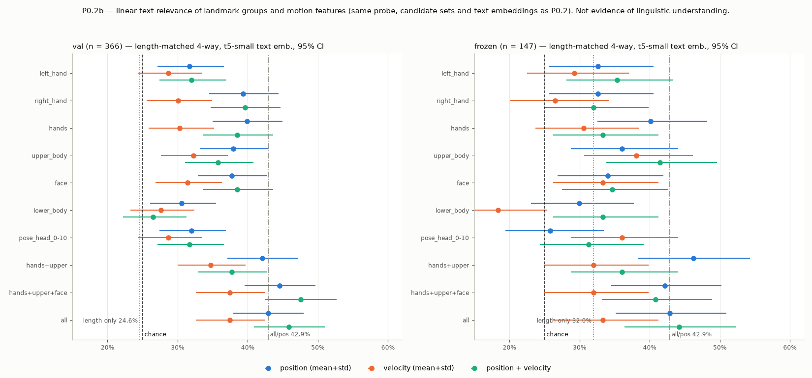

# P0.2b Landmark signal localisation — 2026-09-29

**Question.** The normalised landmark input carries more linearly recoverable text-relevant information than any learned encoder stage (P0.2: 42.9% length-matched 4-way on val and on frozen). Which landmark components and which kinds of motion information account for it?

**Answer (linear probe on per-clip summaries).**
- The signal sits in **hands + upper body (pose 11–22) position**. Those 162 of the 501 input dims (324 summary features) match the all-landmark baseline on both splits: val 42.1% vs 42.9%, frozen 46.3% vs 42.9%, paired Δ n.s.
- Hand shape alone gets most of the way (39.9% / 40.1%), mostly from the **right-hand slot**. Upper body (arm + hand location) alone reaches 38.0% / 36.1%, and the two are complementary.
- **Face** is above chance on its own, but adds no consistent increment over hands + upper body.
- **Lower body** and pose-head points are the weakest groups and add nothing.
- **Explicit velocity/acceleration summaries do not help consistently.** Velocity alone is weaker than position everywhere. Position + velocity is not reliably better than position. Frame shuffling does not consistently destroy anything.
- The baseline is **not a clip-length artefact**. Length alone is at chance on val (24.6%), and the signal survives length residualisation.

No model was run or trained. Only the P0.2 linear probes were fit, on the train split only. P0.1, P0.1b and P0.2 outputs are untouched.

> This is a linear text-relevance probe on time-averaged summaries. It does not establish linguistic understanding, and a null result for velocity here does not mean temporal dynamics are irrelevant to a sequence model.

---

## 1. Harness (reused unchanged from P0.2)

Split discipline, fixed text embeddings (primary: pretrained t5-small encoder mean-pool; secondary: train-fit TF-IDF), ridge probe with λ from 5-fold source-video-grouped CV on train, **the identical deterministic 4-way candidate sets** (`forced_choice_sets_{val,frozen}.json`), tie handling and bootstrap are all imported from `scripts/probe_semantic_retrieval.py`.

**Reproduction guard (asserted):** the new "all / position" features equal P0.2's saved landmark mean+std features bit-for-bit. That probe reproduces P0.2's R@1, R@10, median rank and 4-way numbers exactly (42.9% / 42.9%) for both text embeddings.

Counts: train 2,751 (probe fitting only), val 366, frozen 147 (evaluation only). Chance: 4-way 25%; R@10 2.7% (val, gallery 366) and 6.8% (frozen, gallery 147); R@1 0.27% / 0.68%; median rank 183.5 / 74.

## 2. Landmark groups (actual model-input schema)

Model input per frame = 501 dims = 167 landmarks × (x, y, z), interleaved per landmark: `[pose 33 | left hand 21 | right hand 21 | face 92]`. Normalisation is unchanged (`src/dataset.py`):
- pose: minus mid-shoulder, divided by shoulder width
- each hand: minus **its own wrist**, divided by shoulder width, so the hand blocks encode hand **shape**, while hand **location** is in pose 15–22
- face: minus face centroid, divided by shoulder width
- a missing hand is all-zero (≈ 12% of frames left, 9% right; pose and face essentially never missing)

| Group | Landmarks | Model-input columns | Per-frame dims |
|---|---|---|---:|
| left_hand | MediaPipe `left_hand` slot, 21 pts | 99–161 | 63 |
| right_hand | MediaPipe `right_hand` slot, 21 pts | 162–224 | 63 |
| hands | both | 99–224 | 126 |
| upper_body | pose 11–22: shoulders, elbows, wrists, pose pinky/index/thumb | 33–68 | 36 |
| face | 92-pt face-mesh subset (lips, eyes, eyebrows; `io_utils.MEDIAPIPE_FACE_SUBSET_INDICES`) | 225–500 | 276 |
| lower_body | pose 23–32: hips, knees, ankles, heels, foot index | 69–98 | 30 |
| pose_head_0-10 | pose 0–10: nose, eyes, ears, mouth corners (kept separate so it does not confound "face") | 0–32 | 33 |
| hands+upper | hands + upper_body | 33–68, 99–224 | 162 |
| hands+upper+face | + face | 33–68, 99–500 | 438 |
| all | everything (= P0.2 baseline) | 0–500 | 501 |

The summary features are twice the per-frame dims for one feature type (mean + std), e.g. hands position = 252.

## 3. Feature definitions (pre-specified)

All features are computed on the **exact model input**: `ASLLandmarkDataset(training=False, normalize=True, max_len=150)`, including stride subsampling `x[::ceil(F/150)]` for clips with F > 150 raw frames. Stride is 1 for 60% of train, 45% of val and 54% of frozen clips; up to 11. Every feature is summarised by **mean and std over time**, as in P0.2. There is no padding: each clip is processed alone.

| Feature | Definition |
|---|---|
| **pos** | x_t, t = 0…T−1, over all frames including zero (missing-hand) frames. Identical to P0.2's baseline. |
| **vel** | v_t = (x_t − x_{t−1}) / stride, t = 1…T−1: displacement per *source* frame, so clips subsampled with a larger stride are comparable. **The first frame has no velocity.** A step counts only if the landmark block (pose / left hand / right hand / face) is detected (not all-zero) in **both** frames, so hand drop-outs create no fake jumps. A block with no valid step gets 0. |
| **acc** | a_t = v_t − v_{t−1}, valid only where the block is present in three consecutive frames |
| **pos+vel**, **pos+vel+acc** | concatenation |

**Controls:**
- **Frame-shuffled pos+vel:** frames permuted per clip with a fixed seed, masks recomputed, applied to train and eval alike. Position stats are provably unchanged (asserted), so only the order-dependent velocity part changes.
- **Length-residualised:** each feature is OLS-regressed on [1, log F, log² F, log T] using **train only**, and the residuals are probed.
- **Length only:** [log F, log² F, log T].
- **Velocity not divided by stride** (sensitivity check).

## 4. Main table (primary text embedding = t5-small encoder)

Length-matched 4-way (chance 25%) with 95% Wilson CI; R@10 (chance val 2.7%, frozen 6.8%). The last two columns are the paired-bootstrap Δ vs **all / pos** (the 42.9% baseline), in pp; * = 95% CI excludes 0.

| Landmark group | Feature | Val 4-way [CI] | Frozen 4-way [CI] | Val R@10 | Frozen R@10 | Δ vs all/pos, val | Δ vs all/pos, frozen |
|---|---|---:|---:|---:|---:|---:|---:|
| left hand | pos | 31.7 [27.1–36.6] | 32.7 [25.6–40.6] | 8.2 | 12.2 | −11.2* | −10.2* |
| left hand | vel | 28.7 [24.3–33.5] | 29.3 [22.5–37.1] | 6.3 | 17.0 | −14.2* | −13.6* |
| left hand | pos+vel | 32.0 [27.4–36.9] | 35.4 [28.1–43.4] | 7.4 | 17.7 | −10.9* | −7.5 |
| right hand | pos | 39.3 [34.5–44.4] | 32.7 [25.6–40.6] | 10.1 | 17.0 | −3.6 | −10.2 |
| right hand | vel | 30.1 [25.6–34.9] | 26.5 [20.1–34.2] | 6.6 | 15.6 | −12.8* | −16.3* |
| right hand | pos+vel | 39.6 [34.7–44.7] | 32.0 [25.0–39.9] | 12.8 | 17.7 | −3.3 | −10.9* |
| **hands** | **pos** | **39.9** [35.0–45.0] | **40.1** [32.6–48.2] | 11.5 | 19.0 | −3.0 | −2.7 |
| hands | vel | 30.3 [25.8–35.2] | 30.6 [23.7–38.5] | 7.1 | 17.0 | −12.6* | −12.2* |
| hands | pos+vel | 38.5 [33.7–43.6] | 33.3 [26.2–41.3] | 12.6 | 18.4 | −4.4 | −9.5* |
| hands | acc | 27.9 [23.5–32.7] | 27.9 [21.3–35.6] | 6.6 | 15.0 | −15.0* | −15.0* |
| **upper body** | **pos** | **38.0** [33.2–43.1] | **36.1** [28.7–44.1] | 9.0 | 17.7 | −4.9 | −6.8 |
| upper body | vel | 32.2 [27.7–37.2] | 38.1 [30.6–46.2] | 7.1 | 17.7 | −10.7* | −4.8 |
| upper body | pos+vel | 35.8 [31.1–40.8] | 41.5 [33.8–49.6] | 9.3 | 21.8 | −7.1* | −1.4 |
| face | pos | 37.7 [32.9–42.8] | 34.0 [26.8–42.0] | 9.6 | 16.3 | −5.2 | −8.8 |
| face | vel | 31.4 [26.9–36.3] | 33.3 [26.2–41.3] | 5.5 | 13.6 | −11.5* | −9.5 |
| face | pos+vel | 38.5 [33.7–43.6] | 34.7 [27.5–42.7] | 9.6 | 18.4 | −4.4 | −8.2 |
| lower body | pos | 30.6 [26.1–35.5] | 29.9 [23.1–37.8] | 6.3 | 15.0 | −12.3* | −12.9* |
| lower body | vel | 27.6 [23.3–32.4] | 18.4 [12.9–25.4] | 5.5 | 11.6 | −15.3* | −24.5* |
| lower body | pos+vel | 26.5 [22.2–31.3] | 33.3 [26.2–41.3] | 8.5 | 18.4 | −16.4* | −9.5 |
| pose head 0–10 | pos | 32.0 [27.4–36.9] | 25.9 [19.5–33.5] | 8.7 | 10.9 | −10.9* | −17.0* |
| pose head 0–10 | pos+vel | 31.7 [27.1–36.6] | 31.3 [24.4–39.2] | 9.0 | 12.9 | −11.2* | −11.6* |
| **hands + upper** | **pos** | **42.1** [37.1–47.2] | **46.3** [38.4–54.3] | **16.1** | 21.1 | **−0.8** | **+3.4** |
| hands + upper | vel | 34.7 [30.0–39.7] | 32.0 [25.0–39.9] | 7.7 | 19.0 | −8.2* | −10.9* |
| hands + upper | pos+vel | 37.7 [32.9–42.8] | 36.1 [28.7–44.1] | 12.3 | 20.4 | −5.2 | −6.8 |
| hands + upper + face | pos | 44.5 [39.5–49.7] | 42.2 [34.5–50.3] | 14.8 | 24.5 | +1.6 | −0.7 |
| hands + upper + face | pos+vel | 47.5 [42.5–52.7] | 40.8 [33.2–48.9] | 14.2 | 24.5 | +4.6 | −2.0 |
| **all** | **pos** | **42.9** [37.9–48.0] | **42.9** [35.1–50.9] | 14.8 | 27.9 | baseline | baseline |
| all | vel | 37.4 [32.6–42.5] | 33.3 [26.2–41.3] | 9.8 | 17.0 | −5.5 | −9.5 |
| all | pos+vel | 45.9 [40.9–51.0] | 44.2 [36.4–52.3] | 13.9 | 30.6 | +3.0 | +1.4 |
| all | acc | 31.7 [27.1–36.6] | 29.9 [23.1–37.8] | 6.3 | 18.4 | −11.2* | −12.9* |
| all | pos+vel+acc | 42.1 [37.1–47.2] | 38.8 [31.3–46.8] | 13.1 | 25.2 | −0.8 | −4.1 |
| — | **length only** | **24.6** [20.5–29.3] | 32.0 [25.0–39.9] | 6.3 | 18.4 | −18.3* | −10.9* |

Complete tables (all 58 variants × 2 text embeddings, including R@1, R@5, median rank and TF-IDF): `data/TABLES.md`, `data/results_long.csv`. TF-IDF gives the same qualitative picture: hands+upper pos val 43.7%, all pos 43.2%, lower body pos 23.2% (chance).



## 5. Statistical comparisons (paired bootstrap, same queries and candidate sets; Δ in pp, 4-way length-matched unless noted)

Emb. = text embedding. Full list: `data/paired_tests.csv`.

| Comparison | Emb. | Val | Frozen | Reading |
|---|---|---:|---:|---|
| hands+upper − hands (pos) | t5 | +2.2 [−1.6, +6.3]; R@10 **+4.6*** | +6.1 [−1.4, +13.6] | upper body adds (retrieval sig. on val) |
| hands+upper − upper body (pos) | t5 | +4.1 [−0.5, +9.0]; R@10 **+7.1*** | **+10.2*** | hands add to upper body |
| hands+upper − upper body (pos) | tfidf | **+13.1*** | +2.7 | same direction |
| hands+upper+face − hands+upper (pos) | t5 | +2.5 [−2.5, +7.7] | −4.1 [−11.6, +3.4] | face: no consistent increment |
| hands+upper+face − hands+upper (pos+vel) | t5 | **+9.8*** | +4.8 | only in this variant |
| hands+upper+face − hands+upper (pos / pos+vel) | tfidf | +1.1 / +1.4 | +2.0 / +0.7 | n.s. |
| all − hands+upper+face (pos) | t5 / tfidf | −1.6 / −1.6 | +0.7 / −5.4 | lower body + pose head add nothing |
| vel − pos, hands | t5 | **−9.6*** | −9.5 [−19.7, +0.7] | velocity alone < position |
| vel − pos, all | t5 | −5.5; R@10 **−4.9*** | −9.5; R@10 **−10.9*** | same |
| pos+vel − pos, all | t5 / tfidf | +3.0 / −3.0 | +1.4 / +3.4 | n.s., sign flips |
| pos+vel − pos, hands | t5 / tfidf | −1.4 / +0.3 | −6.8 / −2.7 | n.s. |
| pos+vel − pos, hands+upper | t5 / tfidf | −4.4 / −3.3 | **−10.2*** / +4.1 | not better |
| pos+vel+acc − pos+vel (all 5 key groups) | t5 | −1.4 … −4.1 | −5.4 … +2.7 | acceleration never helps |
| shuffled − ordered pos+vel, all | t5 / tfidf | **−6.6*** / −2.5 | −4.1 / +4.1 | not replicated |
| shuffled − ordered pos+vel, hands | t5 / tfidf | −1.4 / −2.7 | **+8.2*** / −4.1 | mixed sign |
| shuffled − ordered pos+vel, hands+upper | t5 / tfidf | −0.5 / +1.1 | +2.0 / −3.4 | none |
| shuffled − ordered pos+vel, hands+upper+face | t5 / tfidf | **−6.0*** / −1.9 | +1.4 / +0.7 | not replicated |
| shuffled − ordered pos+vel, upper body | t5 / tfidf | −3.3 / −1.4 | **−8.2*** / −0.7 | not replicated |
| length-residualised − raw, all pos | t5 / tfidf | +3.0 / −1.4 | −2.7 / +1.4 | length removal costs nothing |
| length-residualised − raw, hands+upper pos | t5 / tfidf | +0.5 / +0.0 | −0.7 / **+5.4** (CI to 0.0) | same |

**Multiplicity:** about 90 comparisons × 2 metrics × 2 splits × 2 embeddings were run, so isolated `*` results are expected by chance. Conclusions rest only on effects that agree **across val and frozen, and across both text embeddings**.

## 6. Answers

1. **Concentrated in hands?** Largely, not entirely. Hands position (hand shape) reaches 39.9% / 40.1%, a 4-way Δ vs all of −3.0 / −2.7 (n.s.), but R@10 is lower (−3.3* val, −8.8* frozen). The right-hand slot carries most of it: val 39.3% vs left 31.7%.
2. **Does upper body add?** Yes. It carries hand *location* and arm pose (alone 38.0% / 36.1%), which hand shape does not. Together, hands + upper recover the full baseline: 42.1% / 46.3% vs 42.9% / 42.9%, n.s. Hands add significantly to upper body (frozen 4-way +10.2*, val R@10 +7.1*). Upper body adds to hands consistently in direction (+2.2 / +6.1; val R@10 +4.6*).
3. **Does face contribute measurably?** Alone, yes: 37.7% / 34.0%, above chance, possibly partly through correlation with hands and posture. Incrementally, no consistent contribution: over hands + upper it moves +2.5 / −4.1 (pos) with the t5 embedding, and n.s. with TF-IDF. The one significant increment (+9.8* val, pos+vel) is not replicated on frozen or with TF-IDF.
4. **Hip/leg landmarks?** Mainly nuisance. Lower body is the weakest group: 30.6% / 29.9%, and chance-level with TF-IDF (23.2% / 24.5%). Adding lower body + pose head to hands + upper + face never helps (−1.6 / +0.7; TF-IDF −1.6 / −5.4). P0.1 found these dims carry ~57% of the input's raw variance.
5. **Does explicit velocity improve over position?** No. Velocity alone is above chance (≈ 30–37%) but consistently below position: hands −9.6* val, all R@10 −4.9* / −10.9*. Acceleration alone is lower still.
6. **Is pos+vel consistently better than pos?** No. All: +3.0 / +1.4 (t5), −3.0 / +3.4 (TF-IDF), all n.s. Hands and hands + upper are equal or worse (hands + upper −10.2* frozen). The unscaled-velocity variant gives the same answer (all pos+velu 44.0% / 44.2%).
7. **Does frame shuffling destroy a velocity advantage?** There is no consistent velocity advantage to destroy, and shuffling effects do not replicate. The significant losses (all −6.6*, hands + upper + face −6.0*, both val t5) are not seen on frozen or with TF-IDF; hands even improves when shuffled on frozen (+8.2*). Shuffling removes trajectory **order**, not motion **magnitude**: shuffled frame differences still reflect movement variability. Under this probe, order-dependent summaries show no reliable text relevance.
8. **Is the 42.9% baseline explained by clip length?** No. Length alone is 24.6% on val (chance) and 32.0% on frozen (the frozen value reflects imperfect length matching and a wide CI; see P0.2). With length regressed out on train, all / pos stays at 45.9% / 40.1% (Δ +3.0 / −2.7, n.s.). The same holds for every key group.
9. **Minimal landmark representation for the next controlled experiment:** **hands (both, wrist-relative; 126 dims) + upper-body pose 11–22 (36 dims) = 162 dims per frame, position only, current normalisation unchanged.**
   - It matches the 501-d input's linear text relevance on both splits and both text embeddings, with 32% of the dimensions.
   - It drops the lower-body landmarks, which are nuisance and dominate raw input variance, and the pose-head points.
   - **Face:** not supported by these data as an addition. It is linguistically plausible (non-manual markers), so if kept it should be a separately controlled arm.
   - **Velocity:** no explicit velocity/acceleration channels, since they do not add linearly decodable text information. A sequence model can compute differences internally if it needs them.
   - To keep the next experiment controlled, change the input representation and the training objective in separate arms, not simultaneously.

The "all / pos+vel, length-residualised" variant scored highest (48.9% / 46.9%). It is one of 58 variants and was not pre-specified as a candidate, so it is **not** selected.

## 7. Limitations

- Linear ridge probe on mean/std summaries. Temporal structure beyond first and second differences, and non-linear combinations, are not tested. The velocity and shuffle findings apply to *summary statistics*, not to what a sequence encoder could extract.
- Frozen n = 147 (4-way CI ≈ ±8 pp); val n = 366 is the stronger held-out set. No winner was selected on frozen alone.
- The "left/right hand" labels are MediaPipe's slots. There are no signer or handedness labels, so "dominant hand" cannot be verified.
- As in P0.2, what the input signal encodes (lexical content vs topic, signer or style correlates) cannot be determined without further labels. It is not evidence of ASL semantics.

## 8. Files

Model repo `~/Desktop/gloss-free-asl-translation` (untracked; nothing committed):
- `scripts/probe_landmark_localization.py` (new): `features`, `analyse`, `replot`. Imports the P0.2 harness unchanged.
- `results/p02b_landmark_localization/`
  - `features.npz`: per-clip pos/vel/velu/acc mean+std, plus shuffled versions, raw frames, T, stride
  - `analysis/`: `metrics.json`, `results_long.csv`, `paired_tests.csv`, `TABLES.md`, `landmark_localization.png`
  - `analyse.log`

This worktree: `docs/daily_report/9.29/asl-p02b-landmark-localization/` (this report, `figures/`, `data/`).

## 9. Reproduce

```bash
cd ~/Desktop/gloss-free-asl-translation
export HF_HUB_OFFLINE=1
.venv/bin/python scripts/probe_landmark_localization.py features   # ~10 s
.venv/bin/python scripts/probe_landmark_localization.py analyse    # ~7 min, CPU
```

This requires the P0.2 outputs (`results/p02_semantic_probe/`: text embeddings, candidate sets, P0.2 features for the reproduction guard). Both steps refuse to overwrite existing outputs.
